# 稳定高速VPN推荐：40款性价比翻墙梯子完全指南

本文整理44家VPN与翻墙梯子，介绍各家的套餐价格、流量额度、设备支持和使用条件。你可以按浏览网页、使用AI工具或观看流媒体等需求，结合预算与每月用量比较套餐。下文依次提供选购说明、品牌介绍和套餐横向对比，并附注册入口、客户端教程及常见连接问题的处理办法。

**没有任何一家机场或VPN能够一直稳定。** 日常使用时，要对偶尔断联有所预期。2026年4月以来，大陆跨境网络环境经历了多轮收紧。10月下旬[重要会议](https://www.news.cn/politics/leaders/20260921/6d2f7db5a4c1477bb588a75e1ad87a4b/c.html)前后，部分直连和海外中转线路又出现端口受阻、节点超时等情况。进入11月，已有用户反馈连接情况明显改善。

GFW会识别并干扰部分代理流量，节点入口的IP或端口可能因此被封锁。采用AWS入口自动换IP机制的机场或VPN，会监测入口是否可用，发现IP或端口受阻后自动切换入口IP。检测和切换需要时间，期间可能断联几分钟，有时约10分钟。

想看线路调整、故障和恢复的前后记录，可读[网络环境与历史变化](https://github.com/John19187/ssr-v2ray-trojan-clash-guide#network-context)；相关技术背景见GFW的[公开测量研究](https://gfw.report/publications/usenixsecurity23/en/)。

在学校使用时，优先用自己的手机流量，或自己办理、直接连接运营商网络的流量卡；电脑可以连接手机热点。校园网有本校的登录和使用规定，个人流量更方便与校内网络分开使用。具体说明见[校园网与个人流量怎么选](https://github.com/John19187/ssr-v2ray-trojan-clash-guide#campus-use)。

平时多留意你所用机场或VPN服务商的首页公告。节点域名、端口或线路有变化时，按说明更新订阅、切换节点或调整客户端，减少旧配置造成的断联。

原来能用、后来多个节点一起连不上时，先看账户是否到期、流量是否用完，以及服务商首页有没有故障通知。账户正常又没有故障说明，可以保留同一节点，分别用Wi-Fi和自己的手机流量打开同一个网站，看看是不是只在一条网络上失败。具体报错见[连接与DNS问答](#connection-dns-faq)；求助时遮住个人订阅链接和账号信息。

工作、外贸或AI工具使用依赖跨境连接的，可以提前准备一两条备用连接。平时试一下需要的网站能否打开，并留意套餐流量；主用临时中断时，就能切换过去。

### 选套餐时，把价格和实际交付放在一起看

低价方案可以纳入比较。除了每月多少钱，还要看支持哪些设备、给多少流量、有没有试用，以及故障和退款怎样处理。带宽、服务器和维护都需要持续投入；服务长期缺少维护，可能出现高峰卡顿、节点减少或故障无人处理。突然停运、收款后失联，通常被称为“跑路”，未用完的流量和预付款也可能损失。

维护、售后和实际交付记录都说不清楚的服务，慎重用作日常主用，也别只为折扣一次预付数年。准备长付前，算清本次要付的总额、每月流量和退款限制。

想理解服务、客户端、入口与出口的关系，可查[机场与代理工具科普](https://github.com/John19187/ssr-v2ray-trojan-clash-guide#layers)；具体软件按下文对应客户端进入教程，跨软件比较或共同故障再看[2026年机场通用客户端汇总与下载教程中的连接排查](https://github.com/John19187/proxy-client-guides#symptom-table)。

收录：星云、闪连、Cloud-VPN、WgetCloud、大哥云、星链云、杨帆云、极客云、狗狗加速、泰山、NiceDuck、CyberGuard、白月光、闪电、奶昔（Nexitally）、三月七、奶优、轻云、千速喵、青云梯、赔钱、泡泡Dog、牧牛云、Eternal Network、飞鸟、光年梯、龙猫云、夜煞云、YToo歪兔、xgcloud、V2free、XSUS、TAG、STC-SPADES、SpeedCAT闪电猫、红杏、Riolu精灵学院、Coffee Cloud咖啡云 等、咪兔 Mitu-VPN、红杏云、oixcloud。

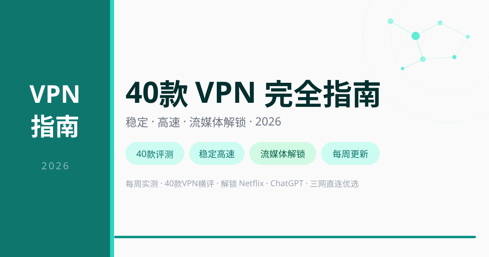

<b>目录：全部 44 款 · 点击展开</b>

[翻墙客户端与使用方式怎么选](#翻墙客户端与使用方式怎么选) · [星云-VPN](#星云-vpn) · [闪连VPN](#闪连vpn) · [Cloud-VPN](#cloud-vpn) · [杨帆云vpn](#杨帆云vpn) · [WgetCloud VPN](#wgetcloud-vpn) · [大哥云-VPN](#大哥云-vpn) · [星链云VPN](#星链云vpn) · [极客云VPN](#极客云vpn) · [狗狗加速-VPN](#狗狗加速-vpn) · [Taishan Net 泰山-VPN](#taishan-net-泰山-vpn) · [疾风云-VPN](#疾风云-vpn) · [尔湾云-VPN](#尔湾云-vpn) · [九霄云-VPN](#九霄云-vpn) · [NiceDuck-VPN](#niceduck-vpn) · [CyberGuard-VPN](#cyberguard-vpn) · [bygcloud白月光-VPN](#bygcloud白月光-vpn) · [闪电-VPN](#闪电-vpn) · [nexitally奶昔-VPN](#nexitally奶昔-vpn) · [三月七-VPN](#三月七-vpn) · [奶优 NaiU_Net-VPN](#奶优-naiu_net-vpn) · [轻云VPN](#轻云vpn) · [千速喵-VPN](#千速喵-vpn) · [青云梯-VPN](#青云梯-vpn) · [赔钱-VPN](#赔钱-vpn) · [泡泡Dog-VPN](#泡泡dog-vpn) · [牧牛云VPN](#牧牛云vpn) · [Eternal Network-VPN](#eternal-network-vpn) · [FLYINGBIRD飞鸟VPN](#flyingbird飞鸟vpn) · [光年梯vpn](#光年梯vpn) · [龙猫云VPN](#龙猫云vpn) · [夜煞云VPN](#夜煞云vpn) · [YToo（歪兔）-VPN](#ytoo歪兔-vpn) · [xgcloud-VPN](#xgcloud-vpn) · [V2free-VPN](#v2free-vpn) · [XSUS-VPN](#xsus-vpn) · [TAG-VPN](#tag-vpn) · [STC-SPADES-VPN](#stc-spades-vpn) · [SpeedCAT闪电猫-VPN](#speedcat闪电猫-vpn) · [红杏-VPN](#红杏-vpn) · [Riolu 精灵学院-VPN](#riolu-精灵学院-vpn) · [Coffee Cloud 咖啡云-VPN](#coffee-cloud-咖啡云-vpn) · [咪兔 Mitu-VPN](#咪兔-mitu-vpn) · [红杏云](#hongxingyun) · [oixcloud](#oixcloud) · [电脑与手机如何选客户端、导入订阅](#电脑与手机如何选客户端导入订阅) · [VPN推荐列表小结](#vpn推荐列表小结) · [更新日志](#更新日志)

[近期连接与校园网DNS常见问题](#connection-dns-faq)

## 翻墙客户端与使用方式怎么选

先看自己准备在哪些设备上使用，再选顺手的连接方式。有些服务安装官方App、登录后即可选择节点；有些则提供订阅，导入Clash、[v2rayN](https://github.com/John19187/proxy-client-guides/blob/main/downloads/v2rayn/README.md#import)或[Shadowrocket](https://github.com/John19187/proxy-client-guides/blob/main/downloads/shadowrocket/README.md#import)（小火箭）等客户端使用。拿到 Clash 订阅，想让电脑和 Android 使用相近的界面，可以按[FlClash 图文教程](https://github.com/John19187/proxy-client-guides/blob/main/downloads/flclash/README.md#packages)选包、添加配置并测试连接。具体支持哪些系统和导入方式，见各家介绍与官方教程。

| 使用方式 | 适用情况 | 选择时确认 |
|---|---|---|
| 官方客户端 | 希望安装、登录后直接使用，减少订阅配置 | 支持的系统、同时在线数量，以及是否只允许本家App |
| 通用客户端导入订阅 | 已有Clash、[v2rayN](https://github.com/John19187/proxy-client-guides/blob/main/downloads/v2rayn/README.md#import)或[小火箭](https://github.com/John19187/proxy-client-guides/blob/main/downloads/shadowrocket/README.md#import)，想继续使用自己的配置 | 订阅格式、协议与当前客户端版本是否兼容 |
| 路由器等设备 | 希望多台设备共用连接或按规则分流 | 本家是否提供适用订阅、设备性能及具体配置教程 |

按场景对号入座：

- 希望少做配置。优先查看官方客户端的安装与使用方式，确认自己的系统受支持；有回国访问需求时，另看是否提供对应线路。
- 需要4K视频、游戏或AI工具。比较目标节点的延迟、丢包和平台可用性，不用套餐标称带宽替代自己网络下的结果。
- 想让路由器上的多台设备使用。先确认服务商提供兼容订阅，再按[路由器与客户端教程](https://github.com/John19187/proxy-client-guides#router)设置分流。
- 有明确隐私要求。比较能公开查阅的日志政策、独立审计范围和账号条件，审计覆盖哪些产品、哪个时间段也要一起看。

只想使用官方App时，星云等专属客户端路线能减少订阅格式配置，但不能继续沿用Clash等第三方客户端；已有Clash规则或路由器配置时，优先比较仍提供兼容订阅的服务。偶尔使用可对照按量包，日常高频使用可比较每月重置的套餐；按量包少了按月续费的安排，也要确认有效期、重复购买和剩余流量规则。

各家机场的横向对比在[多家机场推荐与推广的套餐比较](https://github.com/John19187/ji-chang-tui-jian#airport-comparison)，里面也写了机场突然连不上时该怎么判断和自救。

### 按资料日期比较服务，不用标称带宽排速度名次

本文是多家VPN及节点服务的推荐与推广文章，注册入口含推广链接。套餐、线路和流媒体说明来自各品牌资料；价格看付款周期，设备看同时在线或IP限制，平台支持还看地区与账号条件。

### 先确认用途和接入方式

流媒体要看目标平台和地区，旅行要看目的地及设备，办公还要符合单位网络与账户要求。需要按应用分流、广告拦截或路由器接入，先确认相应客户端和套餐明确支持，再比较价格。安全与隐私看日志政策和适用的独立审计范围，不能只看加密名称。

### 预算比较一次支付金额和实际额度

月付、季付、年付和按量包各有周期。年付按全年总价支付，年价除以12用于月均比较；每月重置额度与整年总量也不同。需要试用或退款，按本家实际条件核对。下方横向表和品牌章节保留具体规格、日期与例外。

### 让套餐覆盖自己的设备

官方App、通用订阅和路由器是三条不同使用路线。自己的电脑、手机要分别满足系统要求；设备数、同时在线数与可用IP数也分别核对。已有可用服务就继续取得兼容配置，换软件不要求一起换套餐。

---

## 星云-VPN

### 星云的客户端与套餐（资料日期：2026-11-05）

星云目前只支持自家客户端，不再提供Clash、小火箭等第三方客户端的订阅。想继续用现有Clash配置或路由器的人，选购时要先看清这项限制。

月付有三档：¥18、100GB、3台客户端；¥38、300GB、15台；¥53.60、500GB、20台。年付从¥76起，每月重置50GB、全年累计600GB，按月发放；其他年付档位和设备数见下方套餐表。

[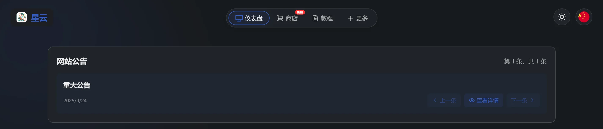](assets/review-images/87cc4af4e1231b56-original.webp)

*星云官网公告与客户端下载入口。*

需要长期按月使用，比较月付或年付；使用频率不固定，可以看后面的不限时流量包。

👉 **[星云-VPN 官网注册入口](https://so.dianlanla.com/xingyun)**

[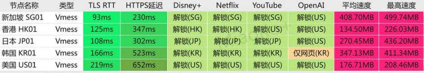](assets/review-images/3a471828d5564921-original.png)
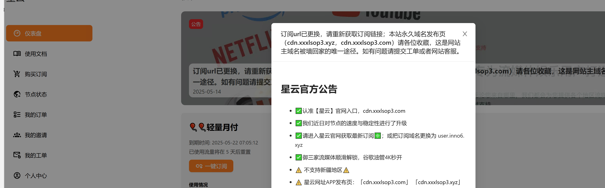

### 主要特点包括：
- **年付配额**：¥76、¥116、¥146、¥176、¥226为一次支付的年价，分别每月重置50GB、100GB、150GB、200GB、300GB。
- **视频与流媒体**：支持YouTube、Netflix等平台。
- **AI与开发工具**：支持ChatGPT、Gemini、Claude、Midjourney、Perplexity、Cursor、Codex和Google Antigravity。
- **节点地区**：香港、台湾、新加坡、日本、韩国、马来西亚、泰国、越南、印尼、印度、柬埔寨、哈萨克斯坦、沙特阿拉伯、美国、加拿大、墨西哥、哥伦比亚、巴西、德国、意大利、英国、西班牙、法国、澳大利亚、俄罗斯、南非、瑞士、瑞典、摩洛哥、以色列、荷兰、克罗地亚、保加利亚、亚美尼亚、摩尔多瓦、比利时、卢森堡、爱尔兰、葡萄牙、新西兰、波兰、希腊、芬兰、冰岛、捷克、拉脱维亚、斯洛伐克、罗马尼亚等
- **跨境专线**：主打企业级跨境专线，可按目标地区与日常高峰时段的连接表现选择节点。
- **全球覆盖**：标称节点覆盖60+全球边缘地区，可按使用地区比较。
- **客户服务**：联系方式与受理时间从本家账户页核对。

- **费用比较**：月付先看每月额度与设备数；年付看全年实付和各月配额，预算有限也要能覆盖自己的用量。
- **线路维护**：日常留意星云首页的入口更新、故障与恢复公告，节点或App变化时及时调整。
- **续费核对**：续费前确认当前套餐、剩余流量与设备上限，区分旧订单权益和新套餐条件。
- **外贸与科研使用**：处理工作或科研资料前，核对本家的日志政策和单位对网络工具、资料传输的要求。

- **客户端**：使用星云自家App，下载和登录按星云教程操作。Clash、[Shadowrocket](https://github.com/John19187/proxy-client-guides/blob/main/downloads/shadowrocket/README.md#import)等通用客户端需要另一种订阅，区别见[专属App与第三方订阅](https://github.com/John19187/proxy-client-guides#client-compatibility)。
[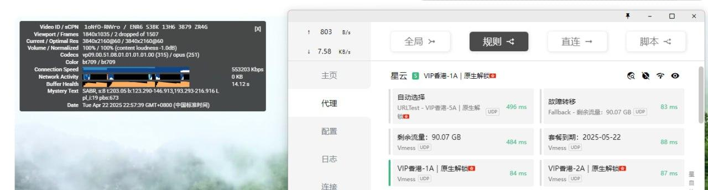](assets/review-images/d0447c2e4463c035-original.jpg)

### 套餐详情介绍

不限时流量包：¥48/200GB、¥109/500GB、¥279/1500GB、¥499/3200GB。较大两档的流量口径仍需向客服确认；这些是不限时总量，不是每月重置额度。

| **套餐类型** | **价格** | **月流量** | **同时登录客户端数** | **标称带宽** |
| ------------ | -------- | ---------- | ------------ | -------- |
| 轻量版       | ¥18.00   | 100GB      | 3            | 800Mbps  |
| 专业版       | ¥38.00   | 300GB      | 15           | 3000Mbps |
| 高级版       | ¥53.60   | 500GB      | 20           | 5000Mbps |

| **套餐类型**   | **价格** | **每月重置流量** | **同时登录客户端数** | **标称带宽** |
| -------------- | -------- | ---------- | ------------ | -------- |
| 特惠限量版     | ¥76.00/年（约每月¥6.33）  | 50GB      | 3            | 3000Mbps |
| 特惠限量Air    | ¥116.00/年（约每月¥9.67） | 100GB     | 10           | 3000Mbps |
| 特惠限量Plus   | ¥146.00/年（约每月¥12.17） | 150GB     | 13           | 5000Mbps |
| 特惠限量Pro    | ¥176.00/年（约每月¥14.67） | 200GB     | 20           | 5000Mbps |
| 特惠限量Ultra  | ¥226.00/年（约每月¥18.83） | 300GB     | 30           | 5000Mbps |

价格、月配额、同时登录客户端数和标称带宽信息截至2026年11月5日。折算月价用于比较支出，当前购买条件以对应套餐页为准。

### 星云优惠码与使用条件

以下优惠信息截至2026年11月5日。选择套餐和付款周期后，在结算页输入对应优惠码，按折后总价付款；前面的套餐表列原价。

| 优惠码 | 折扣 | 适用范围 |
|---|---|---|
| `星云` | 95折 | 公告标明限月付、年付 |
| `xingyun88` | 88折 | 1年付 |
| `xingyun75` | 75折 | 公告标明两年付 |
| `xingyun77` | 77折 | 特惠限量年付系列的套餐说明列为两年付优惠 |
| `xingyun89` | 89折 | 公告标明老套餐 |
| `9999` | 未列明确折扣 | 黄金一次性流量包专属码，优惠金额看结算页验证结果 |

两年付优惠码有`xingyun75`和`xingyun77`两种，适用档位需要在所选套餐的结算页确认。输入代码后，按显示的折后总价付款；活动截止日和叠加规则未明。

**套餐选购建议**

1. 轻度使用者（主要浏览网页、使用ChatGPT）建议选择轻量版月付或特惠限量年付套餐
2. 经常观看流媒体，先按月用量比较专业版月付¥38/300GB与年付¥226、每月300GB档，再核对设备上限与首次支出
3. 多设备或更高流量需求，可比较高级版月付¥53.60/500GB/20台与各年付档；流量、设备数和实际访问表现分别判断
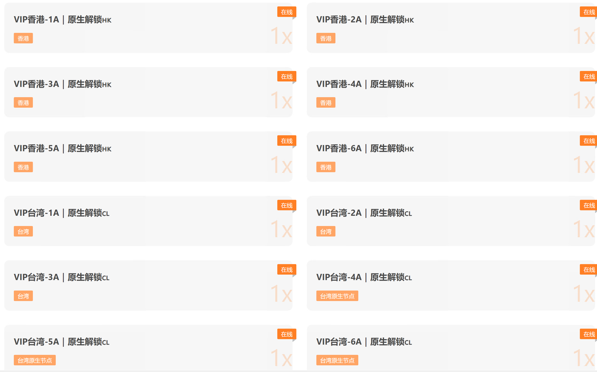
<aside>
星云标称支持ChatGPT、Netflix、Hulu等平台，带宽上限随套餐而异；选购时一起比较地区节点和套餐档位。
</aside>

部分链接可能帮助承担服务器、域名等维护成本，推荐依据不因此改变。

---
## 闪连VPN

👉 **[闪连VPN官网注册入口](https://so.dianlanla.com/shanlian)**

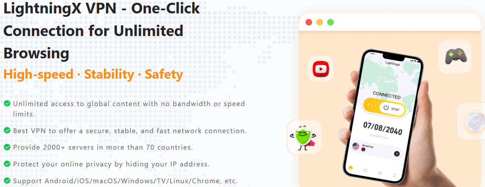

闪连VPN提供独立App、流媒体与AI工具访问，以及回国线路。节点覆盖70多个国家、2000多台服务器，采用自研加密协议，公布无日志政策。

**客户端、线路与支付方式**

* **客户端与并发**：提供全平台原生客户端（iOS/Android/Windows/macOS/Linux/TV及浏览器插件），单账号支持 3 台设备同时在线连接，无需复杂的第三方订阅配置。
* **双向解锁能力**：支持Netflix、Disney+等流媒体，并提供“一键回国”线路。前者用于跨境访问，后者用于海外访问国内游戏或视频。
* **隐私与协议**：公布无日志（No-Log）政策，并介绍自研协议混淆功能；有隐私要求时查看政策记录范围及适用的独立审计。
* **付款方式**：支持支付宝、微信、银联、信用卡、PayPal和USDT。付款后保留订单，使用USDT时也保留交易记录。

### 套餐计划

| 套餐周期           | 周期支付总价     | 支持设备数 | 容量   | 核心适用场景                     | 标签评级                    |
| ------------------ | ---------------- | ---------- | ------ | -------------------------------- | --------------------------- |
| **1 Week (周付)**  | ¥34.33 / 周      | 3 台       | 无限制 | 短期跨国出差、临时应急解锁       | 灵活试用                    |
| **1 Month (月付)** | ¥89.37 / 月      | 3 台       | 无限制 | 月度轻量使用、短期观影需求       | 基础入门                    |
| **3 Month (季付)** | ¥206.33 / 季     | 3 台       | 无限制 | 常规翻墙办公、持续追剧与 AI 调用 | 商店标为Most Popular |
| **1 Year (年付)**  | **¥584.73 / 年** | 3 台       | 无限制 | 连续一年使用，仍限3台同时在线 | 商店标为Best Value |

### 购买建议

* **短期差旅与测试验证** → 选择 **1 Week 套餐**。一次支付¥34.33，使用一周，适合先观察自己的网络与常用网站。
* **高频次日常工具链** → 选择 **3 Month 套餐**。一次支付¥206.33，适合已经确定需要连续使用三个月的用户。
* **已有持续使用需求** → 可比较 **1 Year 套餐** 的一次支付总价、设备数和退款条款；年付折扣与线路后续维护分别考虑。

---

## Cloud-VPN

[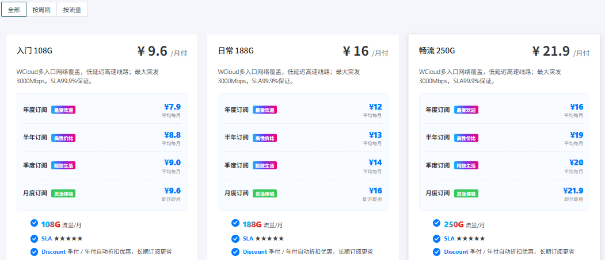](assets/review-images/cloud-vpn-plans-20261117.png)

Cloud-VPN提供月付套餐和不限时流量包。月付从¥9.6、每月108GB起，偶尔使用的用户也可以比较¥56、250GB的一次性流量包。两种套餐的区别在于按月取得额度，还是购买一份不限时总量。

Cloud-VPN通过多个入口自动调度线路，标称最高3000Mbps突发带宽，服务可用率承诺为99.9%（SLA）。节点覆盖50多个国家和地区，共70多个服务器节点，包括美国、日本、新加坡、香港和欧洲等。各档流量、设备数与价格见下表。

👉 **[Cloud-VPN 官网注册入口](https://so.dianlanla.com/wcloudvpn)**

**价格优势**

* 入门套餐仅 **9.6元/月**
* 提供 **不限时流量包**

### 套餐价格（2026年11月5日）

| 套餐 | 每月流量 | 月付 | 季付总价 | 半年总价 | 年付总价 | 两年总价 |
|---|---:|---:|---:|---:|---:|---:|
| 入门 108G | 108GB | ¥9.6 | ¥27 | ¥53 | ¥98 | ¥179 |
| 日常 188G | 188GB | ¥16 | ¥42 | ¥78 | ¥144 | ¥266 |
| 畅流 250G | 250GB | ¥21.9 | ¥59.99 | ¥114 | ¥199 | ¥369 |
| 巅峰 580G | 580GB | ¥46 | ¥129 | ¥240 | ¥456 | ¥879 |

入门、日常、畅流列设备数3、5、10；是否按同时在线计数需向服务方确认，巅峰未列明确设备数。全部套餐说明不支持退款。11月5日年付总价记录为¥98，折算约¥8.17/月，与页面¥7.9的月均标签不一致，付款时确认订单总价。

**不限时总量包：** 250GB／¥56、700GB／¥149、1200GB／¥249、1888GB／¥299，用完为止，不每月重新发放。

旧版套餐与价格记录

以下为旧版记录，保留供原订单对照；新购按上面的资料日期及本家商店查看。

### 套餐价格一览

| 套餐名称 | 月流量   | 月付价格  | 年付均价   | 推荐人群      |
| ---- | ----- | ----- | ------ | --------- |
| 入门套餐 | 108GB | ¥9.6  | ¥7.9/月 | 轻度用户、网页浏览 |
| 日常套餐 | 188GB | ¥16   | ¥12/月  | 日常上网、社交媒体 |
| 畅流套餐 | 250GB | ¥21.9 | ¥16/月  | 流媒体、AI工具  |
| 极速套餐 | 350GB | ¥28   | ¥21/月  | 重度用户      |
| 巅峰套餐 | 580GB | ¥46   | ¥38/月  | 多设备、高频使用  |

**一次性流量包（不限时）**

| 套餐  | 流量     | 价格   | 适合人群  |
| --- | ------ | ---- | ----- |
| 基础包 | 250GB  | ¥56  | 偶尔使用  |
| 扩容包 | 700GB  | ¥149 | 中等需求  |
| 尊享包 | 1200GB | ¥249 | 长期备用  |
| 狂飙包 | 1888GB | ¥299 | 高流量需求 |

 ### 选购建议

| 使用需求                    | 推荐套餐     |
| ----------------------- | -------- |
| 轻度浏览 / ChatGPT / Google | 入门 108GB |
| 日常使用 + 社交媒体             | 日常 188GB |
| 4K视频 / 流媒体              | 畅流 250GB |
| 多设备家庭用户                 | 极速 350GB |
| 重度用户 / 下载               | 巅峰 580GB |

---

## 杨帆云vpn

2025 年开服的杨帆云由海外团队搭建，主线路混搭 IEPL 隧道与 BGP 中转的双层架构，最高规格释放 2000Mbps 带宽，节点投放在香港、台湾、日本、新加坡与美国五地，账号能不能落到这些节点全看套餐档位 — 从LV1到旗舰版逐级开放，LV3含部分IEPL，LV4和旗舰版开放全IEPL；所需地区与线路必须在购买等级的范围内。节点主要使用VMess协议，封装在自研客户端 UniClash 内使用，第三方 [Clash Verge](https://github.com/John19187/proxy-client-guides/blob/main/downloads/old-clash-verge/README.md#migration) 与 [Shadowrocket](https://github.com/John19187/proxy-client-guides/blob/main/downloads/shadowrocket/README.md#import) 在新版加密下连接已不稳定。流媒体与 ChatGPT 的解锁能力随节点等级浮动

👉 **[杨帆云VPN官网注册入口](https://so.dianlanla.com/yangfan)**

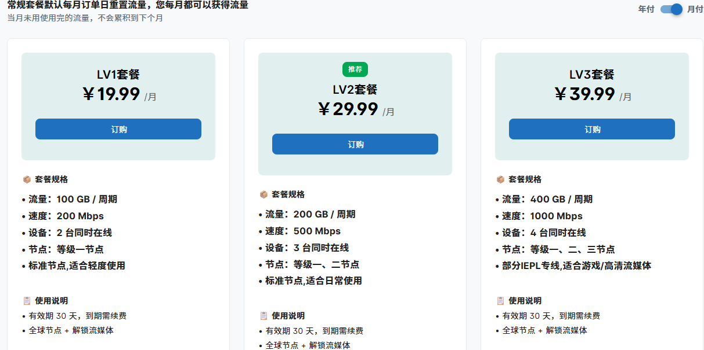

### 杨帆云套餐

| 套餐名 | 月费 | 流量/月 | 设备数 | 速度 | 节点等级 |
|---|---|---|---|---|---|
| LV1 | 19.99 元 | 100 GB | 2 台 | 200 Mbps | 等级一 |
| LV2 | 29.99 元 | 200 GB | 3 台 | 500 Mbps | 等级一、二 |
| LV3 | 39.99 元 | 400 GB | 4 台 | 1000 Mbps | 等级一、二、三（含部分 IEPL） |
| LV4 | 49.99 元 | 700 GB | 6 台 | 2000 Mbps | 全等级（全 IEPL 专线） |
| 旗舰版 | 88.99 元 | 1200 GB | 6 台 | 2000 Mbps | 全等级（含 IEPL） |

选购时先用已有设备的实际月用量对照配额，再比较各档的线路范围与实付金额。4K视频、游戏与会议还受节点负载、本地网络和目标平台影响；多设备使用需另外核对同时在线及共享条件。

> 第三方客户端出现超时不在售后范围内，购买前请确认能接受 UniClash。

***

## WgetCloud VPN

简介：WgetCloud采用国内多线BGP接入、亚马逊 Global Accelerator 加速和香港自营机房，每组节点限制承载人数。选择节点时，可以比较自己网络下的延迟、晚高峰下载速度和目标网站访问情况。

👉 **[WgetCloud VPN官网注册入口](https://so.dianlanla.com/wgetcloud)**

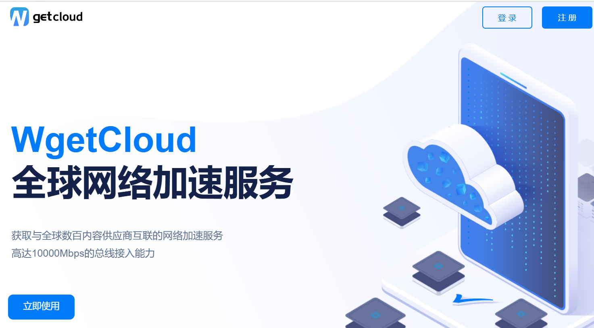

`WgetCloud 基本信息`
开业时间：2021年（原名 GaCloud）
线路协议：Trojan等协议
基础套餐：下表保留过往¥79/月、160GB等记录，当前新购金额与可售周期从本人商店核对
定制套餐：团队或定制产品的流量、IP数与可售状态按本家对应商品确认，不套个人套餐条件
流媒体解锁：支持 Netflix 等主流平台
AI服务解锁：支持 ChatGPT、Gemini 等
节点分布：香港、台湾、日本、新加坡、美国、英国、德国、加拿大、俄罗斯、澳大利亚、马来西亚等
客户端：Clash、[Shadowrocket](https://github.com/John19187/proxy-client-guides/blob/main/downloads/shadowrocket/README.md#import) 等主流订阅客户端
增值服务：不停机、竞速场（独立节点链路资源）

### 帮助中心所列的季付、年付权益

| 等级 | 季付：每30天流量 | 年付：每30天流量 | 可用IP数 | 标称限速 |
|---|---:|---:|---:|---:|
| 基础 | 230G | 280G | 3 | 200Mbps |
| 优质 | 250G | 320G | 4 | 300Mbps |
| 精品 | 270G | 360G | 5 | 500Mbps |

个人套餐金额在账户商店中显示。可用IP数与设备数分开核对；既有订单权益从订单中心查看，下面旧价只供原订单对照。

旧版价格与原订单对照

### 📊 WgetCloud 套餐价格对比表

下表保留过往付款与流量规格，便于老用户对照订单。新购查看账户商店中的可售套餐，续费与既有权益从自己的订单中心核对。

| 项目 | 基础专线 | 优质专线 | 精品专线 |
|---|---|---|---|
| 月付 | ¥79 | ¥89 | ¥99 |
| 月付流量 | 160GB | 180GB | 200GB |
| 季付 | ¥225 | ¥253 | ¥281 |
| 季付流量/月 | 230GB | 250GB | 270GB |
| 年付 | ¥758 | ¥854 | ¥950 |
| 年付流量/月 | 280GB | 320GB | 360GB |
| 协议 | Trojan | Trojan | Trojan |
| 旧年费折算（月均） | 约¥63.17 | 约¥71.17 | 约¥79.17 |

---

## 大哥云-VPN

### 套餐与设备补充（资料日期：2026-09-07）

可月付的两档为¥19.90/100GB、¥29.00/150GB；季付¥69对应每月200GB，年付¥199/¥299分别对应每月300GB/500GB，另有¥88年付、每月15GB的小流量档。套餐说明写明Trojan协议、新疆地区不可用、不支持原路退款。

教程同时包含专属客户端与第三方路线；同日公告建议Windows/macOS用[Clash Verge Rev](https://github.com/John19187/proxy-client-guides/blob/main/downloads/clash-verge-rev/README.md#import)、Android用[Clash Meta](https://github.com/John19187/proxy-client-guides/blob/main/downloads/cmfa/README.md#import)、iOS用[Nextin](https://github.com/John19187/proxy-client-guides/blob/main/downloads/provider-app/README.md#import)，并提示关闭DNS覆写。该提示适用于本家对应教程，不是所有服务商的通用设置。套餐价格与限制见本节说明及购买页面。

**Trojan协议 ｜ 全平台客户端 ｜ 解锁 Netflix/Disney+/TikTok ｜ 不限设备 ｜ 起价 ¥19.9/月**

大哥云-VPN 是 2020 年上线的 Trojan 协议机场，节点覆盖香港、台湾、日本、新加坡、韩国、泰国、越南、菲律宾、美国、英国等国家和地区，支持 Netflix、Disney+、TikTok 等主流流媒体解锁。提供Windows、macOS、iOS、Android对应使用教程；iOS包括Nextin等客户端路线，也支持兼容订阅导入，不限设备数量；支付方式支持支付宝与微信。

- 表中列套餐原价，订单可用优惠见结算页。

👉 **[大哥云-VPN官网注册入口](https://so.dianlanla.com/dageyun)**

[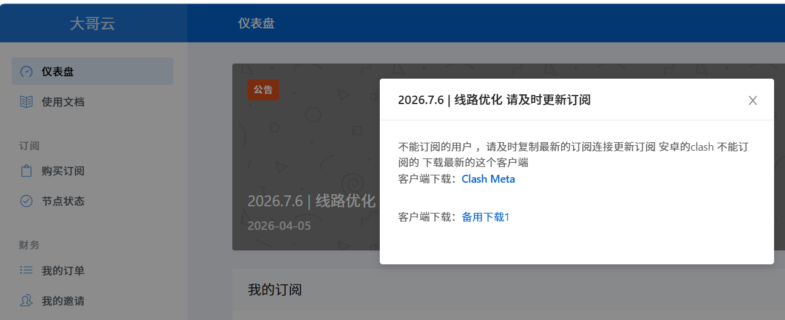](assets/review-images/cad52c4d16f51188-original.png)

###  套餐详情介绍🐉🚀

| **套餐** | **价格** | **每月流量** | **最大带宽** | **适用人群** |
|---------|---------|------------|------------|-------------|
| **单月套餐A** | ¥19.90/月 | 100GB | 500Mbps | 月付尝鲜、日常浏览 |
| **单月套餐B** | ¥29/月 | 150GB | 500Mbps | 月付追剧，先试后买 |
| **季付套餐A** | ¥69/季（月均约¥23） | 200GB | 1000Mbps | 每月200GB、季付总价¥69 |
| **年付套餐A** | ¥199/年 | 300GB | 1000Mbps | 比较年付总价，优惠适用性另核 |
| **年付套餐B** | ¥299/年 | 500GB | 1000Mbps | 大流量档，优惠适用性另核 |
| **VIP小流量年付** | ¥88/年 | 15GB | 500Mbps | 备用保号、轻量需求 |

**推荐方案**
✅ **月付尝鲜 / 先试后买** → **单月套餐A**（¥19.90/月，100GB）  
✅ **需要每月200GB、接受季付** → **季付套餐A**（¥69/季，200GB，月均约23元）  
✅ **长期主力 / 大流量追剧** → **年付套餐B**（¥299/年，每月500GB，购买前核对当前续费与退款条件）
✅ **仅需备用保号** → **VIP小流量年付**（¥88/年，15GB）  

> ⚠️ 全部套餐为 Trojan 协议、按月重置流量，**新疆地区不可用**，且**不支持原路退款**；准备年付时先算清整期支出，确认每月额度和无退款条件。

---

## 星链云VPN

### 套餐与客户端补充（资料日期：2026-09-07）

四档月付记录为¥20/220GB、¥30/480GB、¥40/720GB、¥60/1400GB；说明写每月下单日重置、无在线设备限制。教程提供Windows、Android、macOS、Linux专属客户端下载，iOS另有对应说明。

付款前核对本人可购买档位及设备教程。

星链云开业时间-2023/02/21，线路原生支持解锁流媒体，内容包括 Netflix、Disney、HBO、TVB、Happyon、AbemaTV 等在内的多种流媒体视频。

星链云标称全线路IEPL跨境专线、入口峰值1000Mbps、节点1倍率，支持Netflix、动画疯、HBO、Disney+等流媒体，以及UDPN、NginX+TLS、SecureX等隧道方案。

线路选择可结合本地运营商、晚高峰表现及官方故障公告；注册邮箱验证方式与日志、隐私政策属于不同条件。

👉 **[星链云VPN官网注册入口](https://so.dianlanla.com/xinglian)**

表中列套餐原价，当前优惠见结算页。
### 🚀 **套餐对比表**  

| 套餐名称            | 价格 (¥) | 付款方式  | 每月流量 | 适合用户                 | 其他特点                        |
|------------------|---------|--------|--------|----------------------|----------------------------|
| **星链 Lite**    | ¥20.00  | 月付    | 220GB  | 轻度用户，日常浏览     | 低延迟，中转线路，Netflix/迪士尼解锁 |
| **星链 Pro**     | ¥30.00  | 月付    | 480GB  | 中度用户，稳定观看流媒体 | 低延迟，中转线路，Netflix/迪士尼解锁 |
| **星链 Pro Plus** | ¥40.00  | 月付    | 720GB  | 高流量用户，追剧游戏     | 低延迟，中转线路，Netflix/迪士尼解锁 |
| **星链 Plus Max** | ¥60.00  | 月付    | 1400GB | 大流量用户，下载需求大    | 低延迟，中转线路，Netflix/迪士尼解锁 |

---

### 🌟 **一次性永久流量套餐**
适合备用流量或长期使用，无时间限制，流量用完即止。

| 套餐名称            | 价格 (¥) | 总流量     | 适合用户                 | 其他特点                        |
|------------------|---------|---------|----------------------|----------------------------|
| **1TB 套餐**    | ¥180.00 | 1024GB  | 备用流量，偶尔使用     | 低延迟，中转线路，Netflix/迪士尼解锁 |
| **1.5TB 套餐**  | ¥258.00 | 1500GB  | 中等流量需求         | 低延迟，中转线路，Netflix/迪士尼解锁 |
| **2TB 套餐**    | ¥336.00 | 2000GB  | 大量流量，长期备用     | 低延迟，中转线路，Netflix/迪士尼解锁 |

---

🎯 **选购建议**
- **轻度用户**（日常上网，偶尔使用流媒体）：🔹 **星链 Lite（月付220GB）**
- **中等用户**（经常看流媒体、社交）：🔹 **星链 Pro（月付480GB）**
- **重度用户**（追剧、游戏、大流量需求）：🔹 **星链 Plus Max（月付1400GB）**
- **一次性购买备用流量**：🔹 **1TB/1.5TB/2TB 套餐（永久有效）**

支持Netflix、Disney+等平台；月付按每月额度比较，永久总量包则用完为止。

[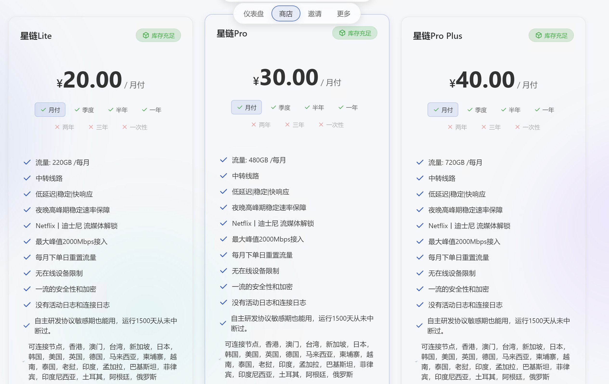](assets/review-images/17bf5fc32eaa9e89-original.png)

---

## 极客云VPN

极客云（JikeCloud），又称极客零（Jike0），成立于2017年，提供近70个付费节点，使用CN2／BGP中转与IPLC线路。服务提供SSR及V2Ray客户端订阅路线，IPLC节点从旗舰版起开放。

**特点**

- **SSR协议与V2Ray客户端路线**：适应不同网络环境。
- **国内中转节点**：可按自己的运营商与所需地区选择入口。
- **IPLC专线节点**：旗舰版以上套餐可用，入门和基础版不包含这组线路。
- **流媒体解锁**：支持解锁Netflix、Hulu等流媒体服务。
- **工单客服支持**：从本家账户页提交具体问题与脱敏报错。

👉 **[极客云VPN官网注册入口](https://so.dianlanla.com/jikeyun)**

### **套餐概览**

| 套餐名称     | 价格      | 流量   | 设备数 | 速率        | 特点                                                   |
| ------------ | --------- | ------ | ------ | ----------- | ------------------------------------------------------ |
| 入门版       | ¥19.99/月 | 100GB  | 2台    | 最高60Mbps  | 国内中转/入门版节点，解锁流媒体                        |
| 基础版       | ¥29.99/月 | 200GB  | 3台    | 最高150Mbps | 国内中转/入门版/基础版节点，解锁流媒体                 |
| 标准版       | ¥39.99/月 | 350GB  | 5台    | 最高300Mbps | 国内中转/入门版/基础版/标准版节点，解锁流媒体          |
| 旗舰版       | ¥59.99/月 | 600GB  | 8台    | 不限速      | 国内中转/入门版/基础版/标准版/IPLC专线节点，解锁流媒体 |
| 旗舰版大流量 | ¥99.99/月 | 1200GB | 10台   | 不限速      | 全部节点可用，解锁流媒体                               |

### **推荐选择**

- **轻度使用（日常浏览）** → 入门版（¥19.99/月）
- **中等需求（流媒体使用）** → 基础版（¥29.99/月）
- **高流量需求（大规模下载）** → 旗舰版大流量（¥99.99/月）

### **优势**

- **CN2/BGP入口**：提供中转入口选择，可按本地网络比较。
- **多协议支持**：适应不同网络环境。
- **流媒体解锁支持**：满足多种流媒体需求。
- **全平台支持**：方便用户使用。

---
## 狗狗加速-VPN

狗狗加速已从Hysteria1升级到Hysteria2。Hysteria2采用基于QUIC的传输与拥塞控制；使用前确认客户端支持它，实际速度还要看当前节点和本地网络。

👉 **[狗狗加速VPN官网注册入口](https://so.dianlanla.com/gougoujisu)**

[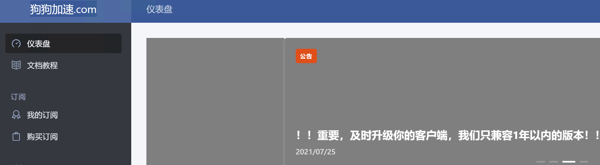](assets/review-images/af9e45e07d5ad818-original.png)

### 🌟 **套餐对比 & 推荐**

| **套餐**     | **价格（每月）** | **流量** | **速率 & 特色**              | **适合人群**         |
| ------------ | ---------------- | -------- | ---------------------------- | -------------------- |
| **标准套餐** | ¥15.80           | 160G/月  | 限速150M，无审计             | 轻度用户，性价比高   |
| **高级套餐** | ¥20.80           | 200G/月  | 不限速，Hysteria协议，低延迟 | 需要每月200G与本档不限速条件   |
| **豪华套餐** | ¥39.80           | 500G/月  | Hysteria2协议，东南亚专线    | 需要东南亚节点及每月500G |
| **定制方案** | ¥1024.80         | 5T/月    | 企业级，-VPN/出海优化         | 企业、专业用户       |

🎯 **推荐选择**

✅ **基础使用，追求性价比** 👉 **标准套餐（¥15.80/月）** 
✅ **需要高级档的流量与速率条件** 👉 **高级套餐（¥20.80/月）** 
✅ **高流量需求 & 海外优化** 👉 **豪华套餐（¥39.80/月）** 
✅ **企业级网络方案 & 定制化需求** 👉 **定制网络（¥1024.80/月）**

- **支持解锁流媒体 & ChatGPT**
- **不限设备，全平台通用**
---

[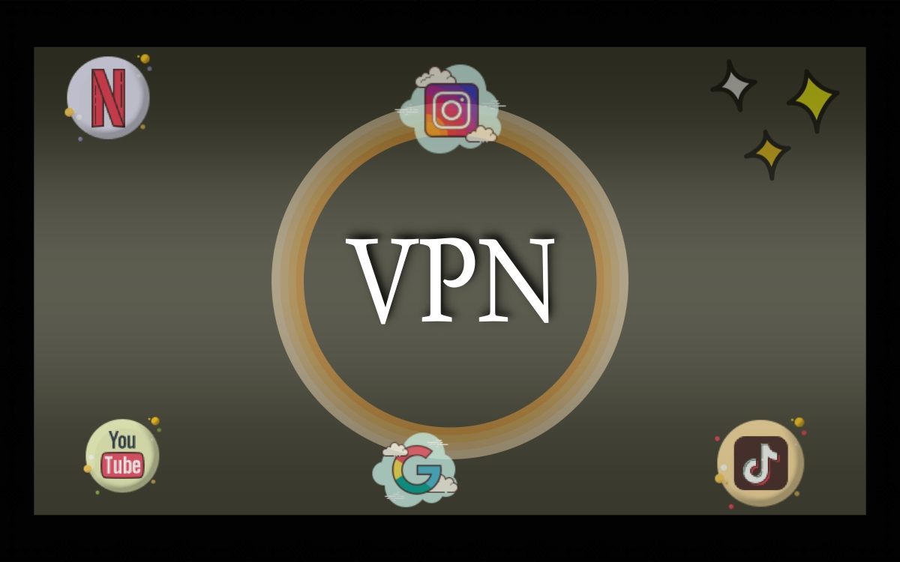](assets/review-images/23c8f5fdcf139f17-original.jpg)

---
## Taishan Net 泰山-VPN

### 当前可核对的购买周期与客户端（资料日期：2026-09-07）

64GB档最低季付¥29，折算月均约¥9.67；128GB、256GB、512GB档月付分别为¥13、¥24、¥42。另有总量200GB/¥78、600GB/¥195的按量包。套餐说明写不限制设备连接数，同时明确无退款政策。

教程覆盖Windows、Android、Apple芯片Mac、Intel Mac专属客户端，也列出[Clash Verge](https://github.com/John19187/proxy-client-guides/blob/main/downloads/old-clash-verge/README.md#migration)、[Nextin](https://github.com/John19187/proxy-client-guides/blob/main/downloads/provider-app/README.md#import)、[Shadowrocket](https://github.com/John19187/proxy-client-guides/blob/main/downloads/shadowrocket/README.md#import)路线。下载时按当前设备与官网教程选包，不把历史版本号当作最新版本。下表价格与额度按同份2026-09-07记录统一，付款时核对当前套餐页。

👉 **[泰山VPN官网注册入口](https://so.dianlanla.com/taishan-net)**

Taishan Net（泰山-VPN）是一家由海外团队运营的服务，成立于2023年5月。周期套餐与不限时流量包可按使用频率选择：64GB档为季付¥29、每月重置64GB，128GB档可月付¥13。支持YouTube、Netflix、Disney及ChatGPT等访问，可用支付宝、微信和USDT付款。

节点分布：拥有40+节点，涵盖美国、香港、台湾、日本、新加坡、德国、英国等地区。
线路类型：提供中转和IPLC专线，IPLC线路具有5倍流量倍率。
客户端支持：按本家当前专属客户端、[Clash Verge](https://github.com/John19187/proxy-client-guides/blob/main/downloads/old-clash-verge/README.md#migration)、[Nextin](https://github.com/John19187/proxy-client-guides/blob/main/downloads/provider-app/README.md#import)或[Shadowrocket](https://github.com/John19187/proxy-client-guides/blob/main/downloads/shadowrocket/README.md#import)教程选择。已拿到小火箭订阅的，可对照[Shadowrocket导入步骤](https://github.com/John19187/proxy-client-guides/blob/main/downloads/shadowrocket/README.md#import)操作；实际订阅仍从本家对应入口获取。

选购时可按预算比较月付、季付与不限时包，留意各自的流量重置规则。
- **设备规则**：套餐说明不限制设备连接数；共享范围仍需按本家条款核对。
- **速率规则**：套餐标示不限速，实际速度还受本地带宽与线路负载影响。
- **流媒体解锁**：支持解锁Netflix、HBO、Disney+等流媒体。
- **SecureX隧道方案**：按本家客户端与教程配置。
- **国内三线骨干网入口**：可按运营商与常用地区选择。
- **负载均衡技术**：优化网络性能。
- **支持渠道**：站内工单与官方Telegram群，入口从泰山账户页进入。

[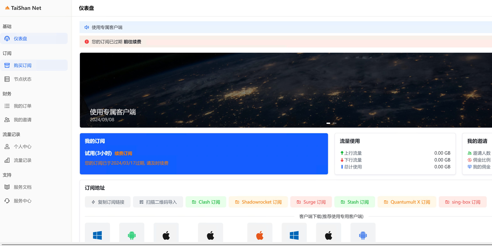](assets/review-images/04c1aba73ed67299-original.png)

### **按周期套餐（2026-09-07记录）**

| 套餐名称 | 付款周期与价格 | 每月流量 | 其他周期 | 特点                                      |
| -------- | --------- | -------- | -------- | ----------------------------------------- |
| 64G流量  | ¥29/季  | 64GB/月  | 购买页核对 | 不限制设备连接数，无退款政策 |
| 128G流量 | ¥13/月 | 128GB/月 | 购买页核对 | 同上                                      |
| 256G流量 | ¥24/月 | 256GB/月 | 购买页核对 | 同上                                      |
| 512G流量 | ¥42/月 | 512GB/月 | 购买页核对 | 同上                                      |

### **不限时流量套餐**

| 套餐名称    | 价格       | 流量   | 特点                                      |
| ----------- | ---------- | ------ | ----------------------------------------- |
| 200G不限时  | ¥78/次  | 200GB  | 总量按使用扣除，不是每月重置；无退款政策 |
| 600G不限时  | ¥195/次  | 600GB  | 同上                                      |

---
## 疾风云-VPN

疾风云是老牌机场团队 2024 年拆出的新分站，走 BGP 中转叠 IPLC 专线的混合线路，低价位吃中转，高档位另开放专线节点。协议覆盖 SSR、V2Ray、Trojan，节点标称 1 倍率，每天登录还能领一点免费额度攒着应急。

- 月付价位跨度大，从入门刷网页到重度多设备可以在同一平台内逐档升级，不用中途换机场。
- 支付只接支付宝和微信，没有 USDT 通道，走加密货币付款的用户绕开这家。
- 具体档位、流量和线路解锁范围以官网当前页面为准，下单前保存当天套餐与订单，便于核对付款和后续权益。

👉 **[疾风云官网注册入口](https://so.dianlanla.com/jifeng)**

[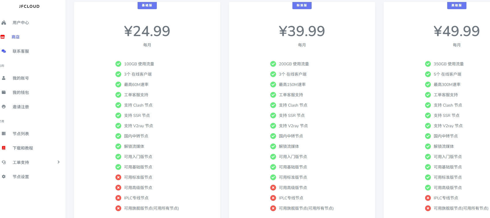](assets/review-images/912c73798d181035-original.jpg)

---
## 尔湾云-VPN

尔湾云于2024年上线，节点覆盖马来西亚、韩国、法国、香港、日本、台湾等8个国家和地区，提供SS、V2Ray订阅。导入时选择与当前客户端兼容的订阅格式。

入门档月付十几元起，旗舰版 Max 接近百元，中间几档按流量与标称速率区分。支持Netflix、TVB等流媒体及ChatGPT。比较年付时，一起看实付总价、流量重置与退款条件。

👉 **[尔湾云官网注册入口](https://so.dianlanla.com/erwan)**

[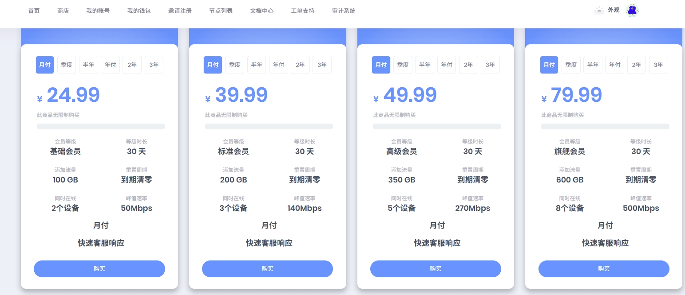](assets/review-images/5d98d9e3d6965504-original.jpg)

---
## 九霄云-VPN

九霄云的套餐结构很直白，四档订阅加一个一次性流量包，价格和流量基本按比例往上叠，不同档位的额度和周期见下表。支付宝、微信都能付，新用户注册有 2 天 8GB 的试用额度，先测节点再决定要不要充值。

| 套餐 | 月费 | 流量 | 备注 |
|---|---|---|---|
| 基础版 | ¥15 | 200GB | 入门刷网页够用 |
| 标准版 | ¥35 | 600GB | 单人重度流媒体的常见选择 |
| 顶配版 | ¥60 | 1500GB | 每月1500GB用量 |
| 流量包 | ¥99（一次性） | 1000GB | 不想按月订阅、临时用一阵子的场景 |
| 海外线路 | ¥680/月 | 10TB | 每月10TB，按本人用量与许可选择 |

支持问题可从本家账户页提交工单；具体档位与购买条件，以官网当前页面披露为准。

👉 **[九霄云官网注册入口](https://so.dianlanla.com/jiuxiao)**

[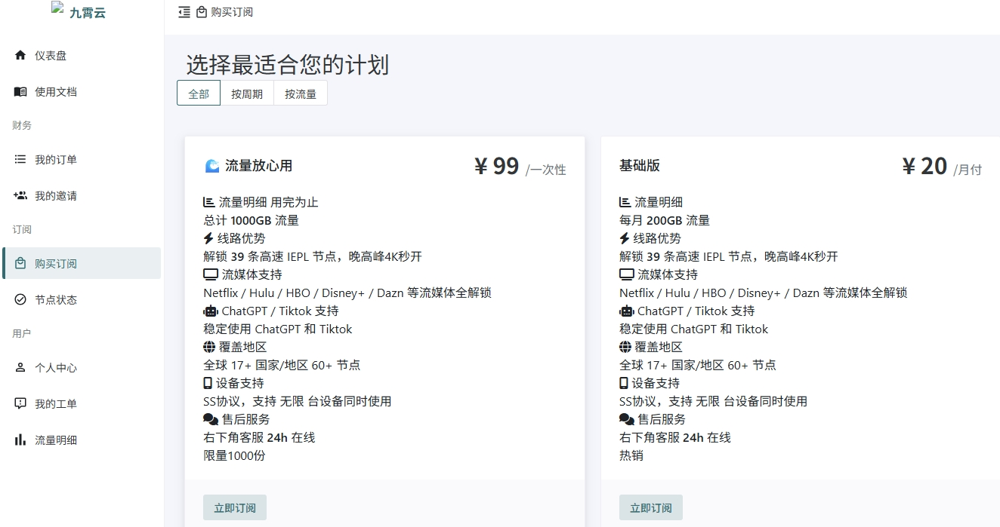](assets/review-images/b423e4b30b9b7897-original.jpg)

---
## NiceDuck-VPN

NiceDuck提供全隧道中转、国内多入口和多地区节点。鸭系列按每月流量分档，比较时同时看付款总额与个人使用限制。

支持Netflix、Disney+、DAZN、动画疯、Abema、DMM等视频平台与ChatGPT。

NiceDuck早期使用Shadowsocks；截至2026年11月5日，鸭系列套餐使用VLESS。Android、iOS、Mac和Windows使用对应的客户端与订阅格式接入。

👉 **[NiceDuck-VPN官网注册入口](https://so.dianlanla.com/niceduck)**

表中列套餐原价，订单可用优惠见结算页。

### 鸭系列套餐（2026年11月5日）

| 套餐 | 每月流量 | 月付 | 季付总价 | 半年总价 | 年付总价 | 两年总价 | 三年总价 |
|---|---:|---:|---:|---:|---:|---:|---:|
| Mini鸭 | 60GB | — | ¥26 | ¥52 | ¥100 | ¥200 | ¥300 |
| 小小鸭 | 100GB | ¥16 | ¥48 | ¥96 | ¥160 | ¥300 | ¥450 |
| 小鸭 | 200GB | ¥32 | ¥96 | ¥192 | ¥320 | ¥600 | ¥900 |
| 中鸭 | 300GB | ¥42 | ¥126 | ¥252 | ¥420 | ¥800 | ¥1199 |
| 大鸭 | 500GB | ¥60 | ¥180 | ¥360 | ¥600 | ¥1100 | ¥1699 |
| 超大鸭 | 1000GB | ¥95 | ¥285 | ¥570 | ¥950 | — | — |

六档均列设备数5，限个人使用、禁止共享订阅、不退款，节点使用VLESS。Mini鸭最低一次付¥26购买一季，每月额度60GB。

旧版套餐与价格记录

以下为旧版记录，保留供原订单对照；新购按上面的资料日期及本家商店查看。

### 🐤 **“鸭系列”套餐（全部月付，部分有季付）**

| 名称 | 流量 | 月付 | 季付 |
| ------ | ------ | ------ | ------ |
| Mini鸭 | 50GB | — | ¥20 |
| 小小鸭 | 100GB | ¥12 | — |
| 小鸭 | 200GB | ¥24 | — |
| 中鸭 | 300GB | ¥32 | — |
| 大鸭 | 500GB | ¥52 | — |
| 超大鸭 | 1000GB | ¥95 | — |

---

---

## CyberGuard-VPN

CyberGuard-VPN成立于2023年，作为一家IEPL专线-VPN，提供IEPL线路和多个国际入口，日志政策从本家公开条款查看。

**CyberGuard-VPN历史优惠记录**：CG666，原记录为首次购买周期套餐八五折；当前是否适用，以结算页显示为准。

CyberGuard-VPN的线路与使用条件

- 提供周期套餐和容量套餐，支持Shadowsocks协议节点；
- 超过14+ IPLC/IEPL企业内网专线线路节点，包括不限于深港专线，热备多路由，AnyCast网络，负载均衡优化；
- 主打香港、日本、韩国、新加坡、美国、德国、荷兰匿名和专线节点，且持续新增；
- 支持Spotify、Netflix、HBO、Disney+等流媒体，以及ChatGPT、TikTok；
- 订阅链接无需转换，全方位支持Windows，macOS，iOS以及Android客户端，
- 常用[Quantumult X](https://github.com/John19187/proxy-client-guides/blob/main/downloads/quantumult-x/README.md#import)，[ShadowRocket](https://github.com/John19187/proxy-client-guides/blob/main/downloads/shadowrocket/README.md#import)，[Loon](https://github.com/John19187/proxy-client-guides/blob/main/downloads/loon/README.md#import)，[Stash](https://github.com/John19187/proxy-client-guides/blob/main/downloads/stash/README.md#import)和Clash等客户端，导入时从本家账户取得对应格式；
- 支持YouTube视频，清晰度与播放速度取决于所选节点和本地带宽；
- 不限制设备数量。
- 提供代理工具教程和工单客服；
- 支持支付宝、微信付款。

👉 **[CyberGuard-VPN官网注册入口](https://so.dianlanla.com/cyberguard)**

### 月付套餐列表：

| 套餐名称 | 月付价格 | 流量 | 最高速率 |
| -------- | -------- | ---- | -------- |
| 轻量套餐 | ¥18.00   | 100G | 300M     |
| 高速套餐 | ¥50.00   | 300G | 1000M    |
| 团队套餐 | ¥72.00   | 720G | 1000M    |
| 企业套餐 | ¥200.00  | 2TB  | 1000M    |

**套餐特点**：

- **IEPL企业级内网专线**：提供专线线路选择，可结合本地网络和故障维护情况比较。
- **流媒体支持**：解锁Netflix、HBO、Disney+、Dazn等流媒体。
- **不限制设备数量**：适合多设备用户。
- **服务可用率承诺**：99%，计算与补偿条件按服务条款执行。

### 不限时流量包套餐

CyberGuard-VPN还提供不限时流量包套餐，适合不同流量需求的用户：

| 流量包 | 价格 |
| ------ | ---- |
| 200G   | ¥79  |
| 700G   | ¥218 |
| 1200G  | ¥360 |

---
## bygcloud白月光-VPN

### 套餐口径与客户端补充（资料日期：2026-09-07）

白月光提供五档季付、一档年付，以及两档有效期为两年的流量包。周期套餐按月给流量，流量包则在两年有效期内共用总额度；这些套餐最多同时在线5台设备。

教程列出Windows/macOS的[Clash Verge](https://github.com/John19187/proxy-client-guides/blob/main/downloads/old-clash-verge/README.md#migration)、Android的[ClashMeta](https://github.com/John19187/proxy-client-guides/blob/main/downloads/cmfa/README.md#import)/[Nekobox](https://github.com/John19187/proxy-client-guides/blob/main/downloads/nekobox/README.md#import)，以及iOS的[ClashMi](https://github.com/John19187/proxy-client-guides/blob/main/downloads/clash-mi/README.md#import)、[Shadowrocket](https://github.com/John19187/proxy-client-guides/blob/main/downloads/shadowrocket/README.md#import)、[Quantumult X](https://github.com/John19187/proxy-client-guides/blob/main/downloads/quantumult-x/README.md#import)、[Surge](https://github.com/John19187/proxy-client-guides/blob/main/downloads/surge/README.md#import)等。按设备平台选择对应客户端，流量重置方式以套餐说明为准。

**bygcloud白月光-VPN加速器**于2021年开设，采用 **Shadowsocks翻墙协议** 和 **IEPL专线节点**，结合负载均衡技术。除按周期购买的套餐外，白月光还提供两年有效期的总量流量包，按自己的用量和最低付款周期比较。

白月光支持 **Netflix**、**Disney+** 和 **ChatGPT**，可按目标平台选择节点地区。

**-VPN节点**分布广泛，包括 **香港、台湾、日本、新加坡、美国、韩国、加拿大、巴基斯坦、马来西亚、菲律宾、澳大利亚、德国、瑞士、英国、波兰、意大利、土耳其、乌兹别克斯坦、阿根廷、巴西、墨西哥、智利、印度、印度尼西亚、泰国、埃及、西班牙、荷兰** 等地区，可按实际需要的出口地区选择。

👉 **[bygcloud白月光VPN官网注册入口](https://so.dianlanla.com/bygcloud)**

### **🔥 专线套餐 & 价格对比** 🚀  

| 套餐 | 付款周期与总价 | 流量额度 | 同时在线设备 |
|---|---|---|---|
| 小包 | 季付¥99 | 每月100GB | 5台 |
| 中包 | 季付¥189 | 每月250GB | 5台 |
| 大包 | 季付¥235 | 每月400GB | 5台 |
| 超大包 | 季付¥325 | 每月750GB | 5台 |
| 不差钱 | 季付¥349 | 每月900GB | 5台 |
| 旗舰包 | 年付¥3750 | 每月2500GB | 5台 |
| 500GB流量包 | 两年¥375 | 两年共500GB；重购立即重置 | 5台 |
| 1000GB流量包 | 两年¥600 | 两年共1000GB；重购立即重置 | 5台 |

**💡 推荐选购**

按每月实际用量比较周期套餐；偶尔备用可比较两年流量包，但重购会重置，先确认剩余额度处理方式。站方条款写明不支持退款、新疆不建议购买，也不保证非三大运营商宽带可用。

## 闪电-VPN

闪电-VPN基于自有专线资源托管服务，标称总冗余10Gbps、最大可突发100Mbps业务带宽。节点包含美国、日本、台湾、香港、新加坡等，支持Netflix、HBO Max、Amazon Prime Video、Disney Now、Disney+等流媒体和ChatGPT。可将订阅导入Clash、[Quantumult X](https://github.com/John19187/proxy-client-guides/blob/main/downloads/quantumult-x/README.md#import)等通用客户端；支持支付宝和微信付款。

👉 **[闪电VPN官网注册入口](https://so.dianlanla.com/shandian)**

[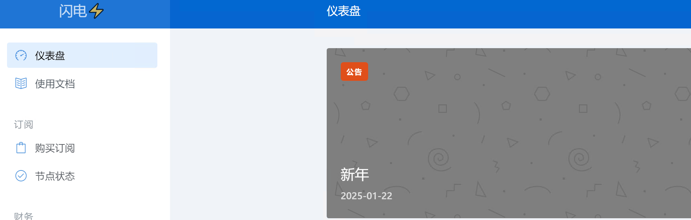](assets/review-images/d24abe97a855626d-original.png)
###  套餐详情介绍

| **套餐**       | **价格**  | **流量**      | **带宽**     | **设备数** | **特点**                       |
|--------------|---------|-------------|-------------|---------|----------------------------|
| **Lv2 畅享**  | ¥14.90/月 | 320GB/月     | 50Mbps     | 3台     | 全球中继线路，Trojan加密协议 |
| **Lv3 尊享**  | ¥23.50/月 | 500GB/月     | 100Mbps    | 5台     | 优质内网跨境专线，Trojan加密协议 |

---

🎯 **推荐选择**
✅ **轻度使用者** 👉 **Lv2 畅享（¥14.90/月，320GB，50Mbps）** 
✅ **高流量 & 需要更快速度** 👉 **Lv3 尊享（¥23.50/月，500GB，100Mbps）**

---
## nexitally奶昔-VPN

**Nexitally（奶昔）-VPN** 成立于2017年，提供Smart Access等专线网络产品。选购按在线设备数和每31天流量比较基础服务，再看是否需要附加服务。旧Smart Access Air的价格保留在下方历史记录。

奶昔-VPN的节点覆盖 **香港、台湾、新加坡、日本、韩国、美国、英国** 等地区，支持 **Netflix、Disney+、MAX、Hulu** 等流媒体平台，可按所需地区选择出口。

此外，奶昔-VPN还支持 **ChatGPT、Claude、Copilot、Gemini** 等AI工具访问；具体账号与地区要求仍由目标平台决定。

🚀 **奶昔-VPN核心优势**：

- **全球节点覆盖**：包括香港、台湾、新加坡、日本、韩国、美国、英国等
- **专线连接**：按常用地区与高峰时段的实际延迟、丢包和访问表现选择
- **解锁流媒体平台**：Netflix、Disney+、MAX、Hulu等平台支持
- **AI 工具支持**：标称支持ChatGPT、Claude、Copilot、Gemini等

👉 **[nexitally奶昔VPN官网注册入口](https://so.dianlanla.com/nexitally)**

[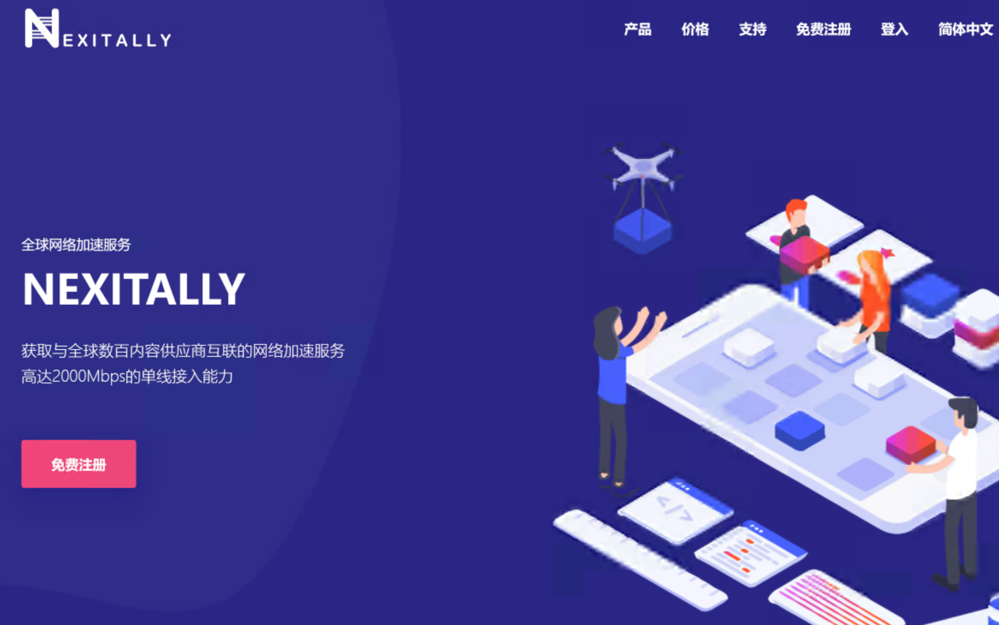](assets/review-images/c0a6010676804e27-original.png)

### 网络套餐（官网价格日期：2026年11月16日）

| 产品 | 一次支付 | 配额与设备条件 |
|---|---:|---|
| Smart Access 31天 | ¥123.33 | 每31天500G，2台在线 |
| Smart Access 186天 | ¥623.70 | 每31天500G，2台在线 |
| Smart Access 372天 | ¥1157.52 | 每31天500G，2台在线 |
| Premium Access | 每31天¥170.10 | 附加服务，需要基础服务 |
| Group Access | 每31天¥47.41 | 附加服务，需要基础服务，至多5台同时在线 |

[网络套餐](https://naiixi.com/Price.aspx)分为基础、附加与商务三类；Premium与Group都需要基础服务。

旧版套餐与价格记录

以下为旧版记录，保留供原订单对照；新购按上面的资料日期及本家商店查看。

### 基础套餐

|             **Smart Access 31 天**             |         **Smart Access 186 天**         |            **Smart Access 372 天**             |
| :--------------------------------------------: | :-------------------------------------: | :--------------------------------------------: |
|                 基础或附加网络服务                 |             基础或附加网络服务              |                 基础或附加网络服务                 |
|                2个在线设备支持                 |             2个在线设备支持             |                2个在线设备支持                 |
|               每31天500G的总流量               |           每31天500G的总流量            |               每31天500G的总流量               |
|                中国大陆BGP中继                 |             中国大陆BGP中继             |                中国大陆BGP中继                 |
|                 智能接入点分配                 |             智能接入点分配              |                 智能接入点分配                 |
|              最高可达2000Mbps带宽              |          最高可达2000Mbps带宽           |              最高可达2000Mbps带宽              |
|                    专线传输                    |                专线传输                 |                    专线传输                    |
|             支持路由器的流媒体解锁             |         支持路由器的流媒体解锁          |             支持路由器的流媒体解锁             |
| 共需人民币 117.46 元,每31天，需人民币117.46 元 | 共需人民币 594 元,每31天，需人民币99 元 | 共需人民币 1102.44 元,每31天，需人民币91.87 元 |

### 轻量套餐

|    **Smart Access Air 31 天**    |    **Smart Access Air 186 天**    |    **Smart Access Air 372 天**    |
| :------------------------------: | :-------------------------------: | :-------------------------------: |
|             轻量网络服务             |             轻量网络服务              |             轻量网络服务              |
|         2个在线设备支持          |          2个在线设备支持          |          2个在线设备支持          |
|        每31天200G的总流量        |        每31天200G的总流量         |        每31天200G的总流量         |
|         中国大陆BGP中继          |          中国大陆BGP中继          |          中国大陆BGP中继          |
|          智能接入点分配          |          智能接入点分配           |          智能接入点分配           |
|       最高可达2000Mbps带宽       |       最高可达2000Mbps带宽        |       最高可达2000Mbps带宽        |
|             专线传输             |             专线传输              |             专线传输              |
|      支持路由器的流媒体解锁      |      支持路由器的流媒体解锁       |      支持路由器的流媒体解锁       |
| 共需人民币71元, 每31天人民币71元 | 共需人民币360元, 每31天人民币60元 | 共需人民币624元, 每31天人民币52元 |

### 附加服务

|                                             |                         |
| :-----------------------------------------: | :---------------------: |
|           **Premium Access X 12**           |    **Group Access**     |
|        日本、美国、韩国 Anycast网络         |     基础或附加网络服务      |
|                中美金融专线                 |     5个在线设备支持     |
|            每31天500G的独立流量             | 每31天，需人民币45.15元 |
|             需要依赖于基础服务              |                         |
|            每31天，需人民币162元            |                         |

---

## 三月七-VPN

三月七按使用范围分为个人、家庭和企业三类。个人档只限本人使用，家庭档允许家人共享，企业档允许企业或工作室商用。各档每月重置流量，同时在线设备上限也随档位变化。

👉 **[三月七VPN官网注册入口](https://so.dianlanla.com/sanyueqi)**

### 三月七套餐价格与设备数

以下为2026年11月14日官网九档套餐的价格、流量与设备数。月付和季付分别是一个月和三个月的实付总价，流量按月重置。

| 套餐 | 月付 | 季付总价 | 每月流量 | 同时在线设备 |
|---|---:|---:|---:|---:|
| 个人套餐 Lv.1 | ¥12.99 | ¥36.99 | 64 GB | 3 台 |
| 个人套餐 Lv.2 | ¥25.99 | ¥73.99 | 128 GB | 6 台 |
| 个人套餐 Lv.3 | ¥51.99 | ¥147.99 | 256 GB | 12 台 |
| 家庭套餐 Lv.4 | ¥103.99 | ¥295.99 | 512 GB | 24 台 |
| 家庭套餐 Lv.5 | ¥207.99 | ¥592.99 | 1024 GB | 48 台 |
| 家庭套餐 Lv.6 | ¥415.99 | ¥1185.99 | 2048 GB | 100 台 |
| 企业套餐 Lv.7 | ¥616.88 | ¥1758.88 | 4 TB | 不限 |
| 企业套餐 Lv.8 | ¥1088.88 | ¥3103.88 | 8 TB | 不限 |
| 企业套餐 Lv.9 | ¥1888.88 | ¥5382.88 | 16 TB | 不限 |

需要比较长周期时，下面列的是一次支付总价，不是月均价；每月流量和同时在线设备数仍按上表对应档位。各档提前重置流量包的价格与该档月付价相同，购买重置包不代替续期。

| 套餐 | 半年付总价 | 年付总价 |
|---|---:|---:|
| 个人套餐 Lv.1 | ¥69.99 | ¥136.99 |
| 个人套餐 Lv.2 | ¥139.99 | ¥273.99 |
| 个人套餐 Lv.3 | ¥279.99 | ¥548.99 |
| 家庭套餐 Lv.4 | ¥560.99 | ¥1098.99 |
| 家庭套餐 Lv.5 | ¥1122.99 | ¥2196.99 |
| 家庭套餐 Lv.6 | ¥2245.99 | ¥4392.99 |
| 企业套餐 Lv.7 | ¥3331.88 | ¥6513.88 |
| 企业套餐 Lv.8 | ¥5226.88 | ¥11498.88 |
| 企业套餐 Lv.9 | ¥10199.88 | ¥22666.88 |

**怎么选**

- 一个人用，先数同时联网的设备，再看每月流量。手机、电脑、平板共三台，每月用量在64 GB以内可选 Lv.1。若要四台同时在线，即使流量够，也要从支持六台的 Lv.2 看起。
- 和家人共用，按全家的合计用量选。Lv.4 每月512 GB、最多24台同时在线；月用量超过512 GB，再比较 Lv.5 和 Lv.6。
- 工作室或企业商用，从 Lv.7 起按每月4、8、16 TB选。三档均不限同时在线设备，月流量仍有上限。站方注明虚拟商品不支持退款。

---

## 奶优 NaiU_Net-VPN

NaiU_Net-VPN成立于2023年10月，使用深港IEPL专线，提供SS节点与UDP支持。游戏或流媒体使用时，按所需地区选择支持的节点。

👉 **[奶优NaiU_Net VPN官网注册入口](https://so.dianlanla.com/naiyou)**

### **特点**

- **深港IEPL专线**：按1倍率扣除流量。
- **中转线路**：有0.2倍率的低倍率中转线路，适合流量大户。
- **全平台支持**：支持Windows、macOS、iOS、Android等多种操作系统。
- **平台支持**：Netflix、Disney+等流媒体及ChatGPT。
- **节点分布**：覆盖香港、台湾、日本、新加坡、美国、马来西亚、英国、德国等国家和地区。

 **价格与付款条件**

表中列套餐原价，订单可用优惠见结算页。

###  套餐详情介绍

| 套餐 | 月付总价 | 季付总价 | 半年总价 | 年付总价 | 每月流量 | 流量重置费用 |
|---|---|---|---|---|---|---|
| Mini | — | ¥31 | ¥61 | ¥119 | 50G | ¥9.90 |
| Nano | ¥19.80 | ¥56.40 | ¥106.90 | ¥202 | 100G | ¥19.80 |
| Micro | ¥33 | ¥94 | ¥178.20 | ¥336.60 | 200G | ¥33 |
| Small | ¥45.10 | ¥128.50 | ¥243.50 | ¥460 | 350G | ¥45.10 |
| Medium | ¥70.40 | ¥200.60 | ¥380.10 | ¥718.10 | 700G | ¥70.40 |
| Large | ¥121 | ¥344.80 | ¥653.40 | ¥1234.20 | 1500G | ¥121 |

- 每月50G以内、接受季付起购，可比较Mini；需要月付则从Nano起选。
- 按自己的每月用量比较100G、200G、350G、700G和1500G，不把较长付款周期的折算月费当成可月付价格。
- 提供深港和沪日专线；购买前向客服确认所选套餐允许的设备数。
  [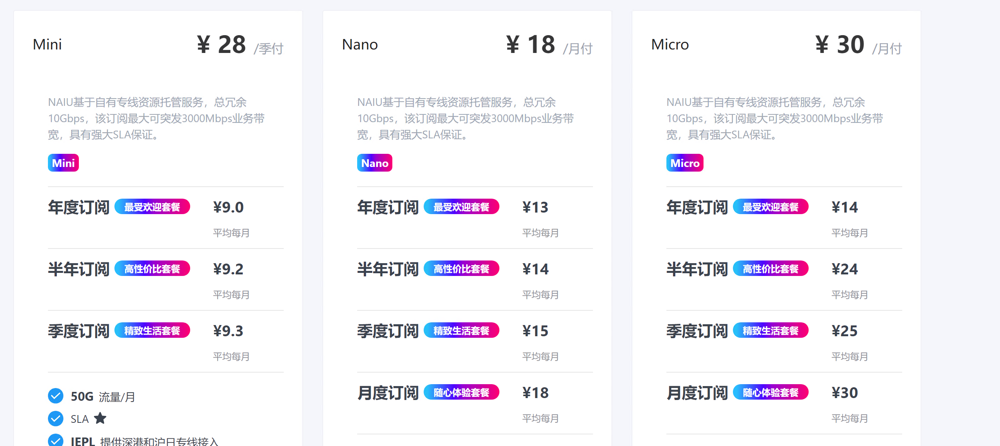](assets/review-images/cac5f2e3a3cff195-original.png)
***

---

## 轻云VPN

- **全球节点**：拥有全球多区域节点，支持访问YouTube、Twitter、Facebook等外网门户。
- **流媒体解锁**：支持解锁Netflix、HBO、Spotify、Disney+、Hulu等流媒体。
- **设备支持**：不限同时在线设备数，适合多设备用户。
- **客户服务**：提供线上客服渠道。
- **性价比高**：价格亲民，适合预算有限的用户。
- **节点覆盖广泛**：提供全球多区域节点，可按目标地区选择。

👉 **[轻云VPN官网注册入口](https://so.dianlanla.com/qingyun)**

[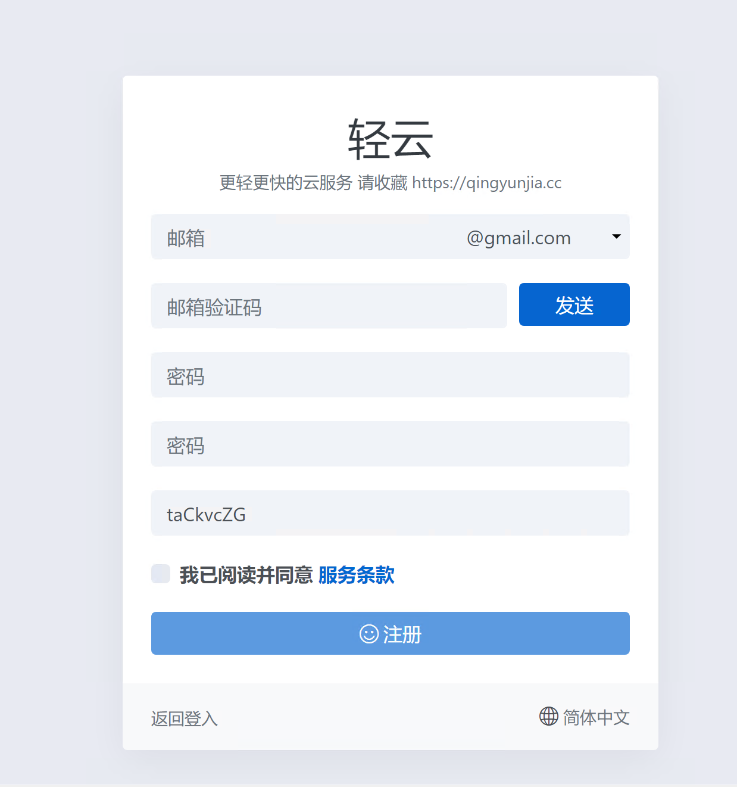](assets/review-images/d8973e0477f7d223-original.png)

### 月度额度与年度额度（2026年11月4日）

| 商品 | 月付 | 季付总价 | 半年总价 | 年付总价 | 两年总价 | 额度 |
|---|---:|---:|---:|---:|---:|---|
| 100G流量/月 | ¥14 | ¥36 | ¥72 | ¥119 | ¥202 | 100GB/月 |
| 200G流量/月 | ¥24 | ¥70 | ¥118 | ¥215 | ¥407 | 200GB/月 |
| 500G流量/月 | ¥72 | ¥179 | ¥299 | ¥539 | ¥1019 | 500GB/月 |
| 100G流量/年_适合小用量 | — | — | — | ¥72 | — | 100GB/年 |
| 300G流量/年_适合小用量 | — | — | — | ¥108 | — | 300GB/年 |
| 500G流量/年_适合小用量 | — | — | — | ¥238.8 | — | 500GB/年 |

六档均标称1000Mbps峰值、同时在线不限。小用量年套餐每年100／300／500GB，不能按每月额度使用；年额度怎样到账和重置，购买前向服务方确认。

旧版套餐与价格记录

以下为旧版记录，保留供原订单对照；新购按上面的资料日期及本家商店查看。

###  套餐详情介绍 

| 套餐                     | 价格    | 计费方式 | 流量额度 | 退款政策 | 速率上限 | 其他特点                                               |
| ------------------------ | ------- | -------- | -------- | -------- | -------- | ------------------------------------------------------ |
| **100G流量/月**          | ¥12.00  | 月付     | 100G     | -        | 1000Mbps | 全球多区域节点，在线客服渠道                       |
| **200G流量/月**          | ¥19.90  | 月付     | 200G     | -        | 1000Mbps | 全球多区域节点，在线客服渠道                       |
| **500G流量/月**          | ¥59.90  | 月付     | 500G     | -        | 1000Mbps | 全球多区域节点，在线客服渠道                       |
| **100G流量/年** (小用量) | ¥59.90  | 年付     | 100G/年 | -        | 1000Mbps | 全球多区域节点，在线客服渠道，送小火箭[Shadowrocket](https://github.com/John19187/proxy-client-guides/blob/main/downloads/shadowrocket/README.md#import) |
| **300G流量/年** (小用量) | ¥89.90  | 年付     | 300G/年 | -        | 1000Mbps | 全球多区域节点，在线客服渠道，送[小火箭Shadowrocket](https://github.com/John19187/proxy-client-guides/blob/main/downloads/shadowrocket/README.md#packages) |
| **500G流量/年** (小用量) | ¥199.90 | 年付     | 500G/年 | -        | 1000Mbps | 全球多区域节点，在线客服渠道，送[小火箭Shadowrocket](https://github.com/John19187/proxy-client-guides/blob/main/downloads/shadowrocket/README.md#packages) |

---

## 千速喵-VPN
千速喵（TSmeow）提供中转及专线套餐，付款周期和价格见下表。

 主要特点：
- **线路类型**：采用IEPL和IPLC专线，针对性隧道路线设计，专线开放范围按所选套餐区分。
- **流媒体解锁**：支持解锁Netflix、迪士尼等流媒体，适合用户观看高清视频。
- **游戏专线**：提供游戏专线，可按目标游戏地区和实际延迟选择节点。
- **流量和速度**：下表未列各档流量额度；选购前先核对额度和设备限制，再比较价格。

[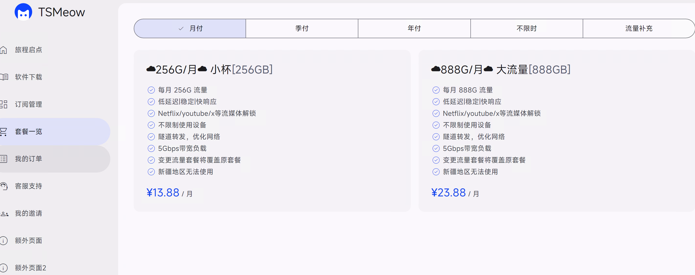](assets/review-images/f5fa1bf15b288242-original.png)

 **价格与付款条件**
表中列套餐原价，订单可用优惠见结算页。

### **千速喵套餐对比与推荐** 🐱🚀  

| **套餐** | **月付／一次性** | **季付** | **年付** | **适用人群** |
|---------|--------|--------|--------|-------------|
| **小杯极速尝鲜** | ¥13.88 | ¥36 | ¥138 | **入门用户，轻度使用** |
| **大流量极速畅** | ¥23.99 | ¥66 | ¥239 | **中等需求，流媒体 & AI工具** |
| **专线专属套餐（标准）** | ¥16.88 | ¥46 | ¥166 | **需要标准专线档，先核流量额度** |
| **专线专属套餐（高级）** | ¥31.88 | ¥88 | ¥310 | **需要高级专线档，先核节点范围** |
| **一次性 333GB** | **¥38.88** | — | — | **流量包，适合偶尔额外需求** |
| **一次性 777GB** | **¥68.88** | — | — | **大流量用户，长期备用** |

 **推荐方案**
✅ **日常轻度使用** → **小杯极速尝鲜**（最低价格）  
✅ **流媒体 / AI用户** → **大流量极速畅**（高性价比）  
✅ **需要专线范围** → 比较**专线专属套餐（标准/高级）**的节点地区和用量条件  
✅ **短期流量补充** → **一次性流量包**（灵活选择）  

---
## 青云梯-VPN
青云梯-VPN成立于2021年，采用IPLC专线，按1倍率计费。

支持Netflix、Disney+、HBO MAX等流媒体；

支持解锁ChatGPT、bing等ai工具；

覆盖的线路涵盖香港、台湾、日本、新加坡、美国、韩国、越南、菲律宾、泰国、印度、德国、法国、英国、阿根廷等地。

### 🌟 **青云梯套餐对比 & 推荐**  

| **套餐**        | **价格（每月）** | **流量**  | **速率 & 特色**                        | **适合人群**               |
|---------------|--------------|---------|--------------------------------|----------------------|
| **年付小包**   | ¥8/月（年付96）  | 60G/月  | 无限速，IPLC专线 | 轻量用户，低成本选择 |
| **VIP1**      | ¥25         | 150G/月 | IPLC专线，流媒体解锁 | 每月150G用量  |
| **VIP2**      | ¥45         | 300G/月 | IPLC线路，按本档配额 | 需要更多流量的用户 |
| **VIP3**      | ¥85         | 600G/月 | 客服支持、TikTok访问 | 高需求用户 |
| **VIP4**      | ¥150        | 1000G/月 | IPLC线路、1倍率 | 极限需求用户 |
| **定制节点**  | ¥680        | 500G/月 | 独享原生IP | 企业 & 电商 |

---

 🎯 **推荐选择**
✅ **预算有限，轻量使用** 👉 **年付小包（¥8/月）**  
✅ **标准流量 & 适合日常使用** 👉 **VIP1（¥25/月）**  
✅ **需要更高流量额度** 👉 **VIP2（¥45/月）**  
✅ **按VIP3额度与线路选档** 👉 **VIP3（¥85/月）**  
✅ **极限流量需求** 👉 **VIP4（¥150/月）**  
✅ **独享IP & 企业级服务** 👉 **定制节点（¥680/月）**  

---
## 赔钱-VPN

**赔钱-VPN**成立于2022年，提供三网线路，最高标称带宽为**20000Mbps**。

此外，**赔钱-VPN**还包括多个 **中转高速节点** 和 **0.1倍下载节点**，可按实际节点倍率估算扣量。该平台不限制 **客户端数量**，让多设备同时连接更加便捷。同时，平台还支持 **流媒体解锁**，所需平台可用性按节点与地区查看。

👉 **[赔钱VPN资料与入口查询](https://so.dianlanla.com/peiqian)**

### **赔钱-VPN 价格 & 套餐汇总 🍹**  

| **套餐** | **月付** | **半年付** | **年付** | **两年付** | **三年付** | **适用人群** | **推荐选购** |
|---------|--------|--------|--------|--------|--------|-------------|-------------|
| **中瓶可乐** | ¥1.99 | ¥9.90 | ¥18.80 | ¥32.80 | ¥48.80 | **超低价，轻度使用** | 💰 **预算有限，基础上网** |
| **大瓶可乐** | ¥3.99 | ¥19.99 | ¥36.99 | ¥64.80 | ¥96.80 | **日常使用，适合个人** | 本档可按月或长周期付款 |
| **超大瓶可乐** | - | ¥35.99 | ¥59.99 | ¥108.00 | ¥168.00 | **半年起购，流量额度待确认** | 🚀 **大流量刚需用户推荐** |

---

### **📦 一次性流量包（不限时）**
| **套餐** | **价格** | **流量** | **适用人群** | **推荐选购** |
|---------|--------|--------|-------------|-------------|
| **一会嗦一口** | ¥14.9 | 1000GB | **备用流量，灵活使用** | 💡 **短期流量补充** |
| **一会嗦** | ¥38.9 | 4000GB | **中等需求，长期备用** | 4000GB总量，不按月重置 |
| **一大口** | ¥49.9 | 6000GB | **6000GB总量需求** | 🔥 **大流量划算选择** |
| **至尊套餐** | ¥188.88 | 20000GB | **超大流量用户** | 🎯 **长期高流量，超值** |
| **顶级王冠永久无限** | ¥688 | 99999GB | 99999GB不限时总量 | 总量有限，用完为止 |
---
[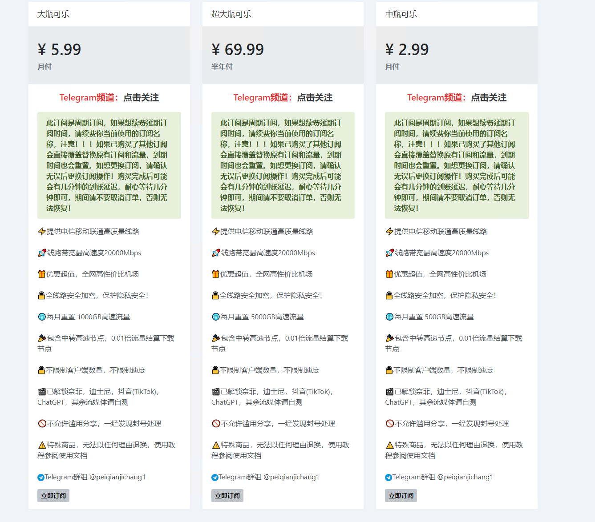](assets/review-images/dd6135a7e587021c-original.png)

---
## 泡泡Dog-VPN

**泡泡Dog-VPN** 成立于2022年，提供大陆国际专线传输、IPLC与多运营商优化线路。可按流媒体、ChatGPT访问及每月用量选择套餐，具体平台访问与节点范围在使用时分别确认。

**泡泡Dog-VPN** 标示采用secure加密隧道，支持支付宝和微信支付。客户端下载与订阅配置按本家教程操作。

👉 **[泡泡Dog VPN官网注册入口](https://so.dianlanla.com/paopaodog)**

[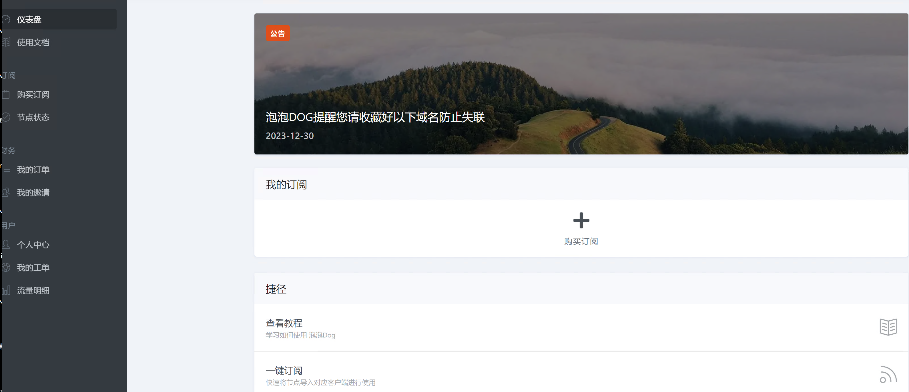](assets/review-images/351e4c88bbff080f-original.png)

### 套餐详情介绍  

| **套餐名称** | **价格及付款周期** | **流量**  | **特点** | **适合人群** |
|------------|--------------|---------|---------|-------------|
| **88G 白银** | ¥14.00/月  | 88GB/月 | **轻度使用**，不限设备 | **日常轻量级需求** |
| **268G 铂金** | ¥25.00/月  | 268GB/月 | **主流流量需求** | **中度使用者（流媒体 + AI）** |
| **688G 钻石** | ¥55.00/月  | 688GB/月 | **大流量需求** | **高清视频、AI、大文件传输** |
| **888G 秋季限定** | ¥106.00/年 | 888GB/年 | **一次性到账，不限速** | **一年内按需消耗888GB** |

 **推荐选择**
- **低成本 & 轻度使用** → **88G 白银 ¥14/月**
- **每月268GB用量** → **268G 铂金 ¥25/月**
- **每月688GB用量** → **688G 钻石 ¥55/月**
- **一年总量888GB，可按需消耗** → **888G 秋季限定 ¥106/年**

---
## 牧牛云VPN

牧牛云提供三个公益节点、**IPLC 中继和专线**，节点总数超过50个，支持 **Shadowsocks(R)** 协议。使用SS或SSR客户端时，选择对应协议和订阅格式。

🌟 **牧牛云VPN特色**：

- **50+ 高质量节点**，包含公益节点，满足各类上网需求  
- 支持 **IPLC 中继和专线**，提供不同线路选择
- 解锁流媒体平台：Netflix、TVB、HBO GO、Fox+ 等  
- 适配 **Shadowsocks(R)** 协议，客户端需支持实际SS或SSR协议及本家提供的订阅格式  
- **试用套餐**：本节套餐表列 **￥8/周、35GB**，下单前核对当前可购价与试用条件

- 

###  套餐详情介绍

| 套餐名称      | 价格      | 流量   | 重置周期 | 同时在线 | 峰值速率 | 会员等级 | 描述                                     |
| ------------- | --------- | ------ | -------- | -------- | -------- | -------- | ---------------------------------------- |
| **试用套餐**  | ¥8.00/周  | 35 GB  | 到期清零 | 无限制   | 150Mbps  | VIP1     | 全球节点分布，客服支持，全平台客户端 |
| **青铜套餐**  | ¥20.80/月 | 90 GB  | 到期清零 | 无限制   | 100Mbps  | VIP1     | 全球节点分布，客服支持，全平台客户端 |
| **白银套餐**  | ¥32.80/月 | 180 GB | 到期清零 | 无限制   | 200Mbps  | VIP2     | 全球节点分布，客服支持，全平台客户端 |
| **白银+套餐** | ¥52.80/月 | 350 GB | 到期清零 | 无限制   | 300Mbps  | VIP2     | 全球节点分布，客服支持，全平台客户端 |

**选购建议**：

- **试用套餐**适合短期测试使用，提供35GB流量和150Mbps峰值速率，适合尝试服务。
- **青铜套餐**列90GB、100Mbps；比周付35GB多出额度，但标称速率低于周付150Mbps，别只看套餐名判断速度。
- **白银套餐**列180GB、200Mbps，适合用量超过90GB但在180GB以内的人比较；先按同一周期计算。
- **白银+套餐**列350GB、峰值300Mbps，主要多出流量与标称上限；到期剩余流量仍会清零，购买时按实际用量安排。

所有套餐到期后剩余流量将清零，并且套餐不支持退款，购买前请确保您的需求。
[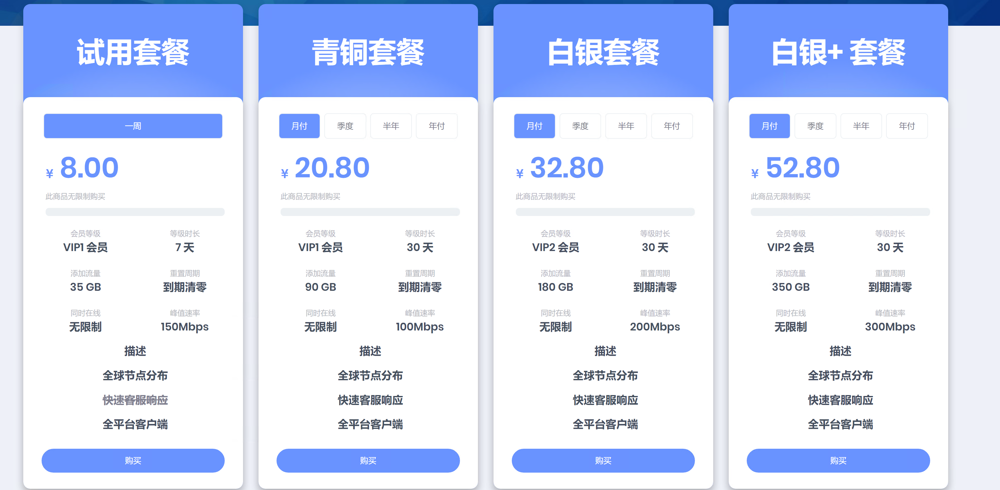](assets/review-images/cee940f39d3d7741-original.png)

---
## Eternal Network-VPN

Eternal Network-VPN提供IPLC与多运营商线路，最高标称带宽5Gbps，支持流媒体和ChatGPT。

提供原生ISP出口，支持Netflix、Disney+等平台。

支付方式支持支付宝和微信。

👉 **[Eternal Network VPN官网注册入口](https://so.dianlanla.com/eternal)**

[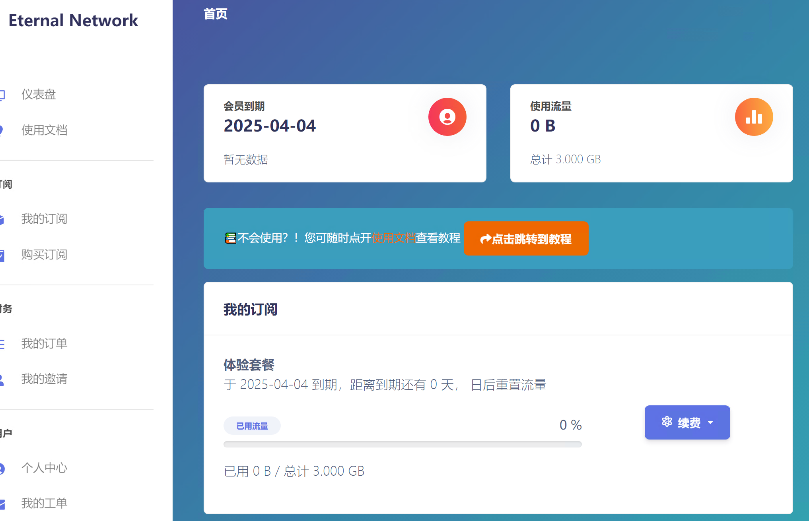](assets/review-images/e7ebb47e44b1b6e0-original.png)

###  套餐详情介绍

| **套餐名称**  | **价格**  | **流量**   | **带宽**         | **适用人群** |
|--------------|----------|-----------|-----------------|--------------|
| **焦糖布丁 🍮**  | ¥6.00/月  | 60GB       | **5Gbps**        | **轻度用户**，低成本流媒体 |
| **芒果奶昔 🧁**  | ¥10.00/月 | 130GB      | **5Gbps + IPLC** | **日常流媒体 + AI** |
| **黄油曲奇 🍪**  | ¥16.00/月 | 245GB      | **5Gbps + IPLC** | **高清流媒体，Netflix 4K** |
| **奶油奶酪 🧀**  | ¥23.00/月 | 335GB      | **5Gbps + IPLC** | **高流量需求**，日常大流量 |
| **芝士蛋糕 🎂**  | ¥38.00/月 | 720GB      | **5Gbps + IPLC** | **每月720GB用量** |

 **推荐选择**
- **只需解锁流媒体，低成本方案** → **焦糖布丁 ¥6/月**
- **追剧党+日常AI需求（性价比高）** → **芒果奶昔 ¥10/月**
- **高清4K流媒体+大数据传输** → **黄油曲奇 ¥16/月**
- **大流量用户（工作/下载）** → **奶油奶酪 ¥23/月**
- **每月720GB用量** → **芝士蛋糕 ¥38/月**

---

## FLYINGBIRD飞鸟VPN

飞鸟-VPN采用SS协议、IPLC专线和海外落地节点，不限速、不限设备数量。全球线路超过70条，节点覆盖中国香港、中国台湾、日本、新加坡、马来西亚、土耳其、阿根廷和美国等地区。支持Netflix、Hulu、HBO、TVB、动画疯等流媒体，可按所需出口地区选择节点。

* * *

 FLYINGBIRD飞鸟-VPN价格与付款

表中列套餐原价，当前优惠见结算页。

👉 **[FLYINGBIRD飞鸟VPN官网注册入口](https://so.dianlanla.com/flyingbird)**

[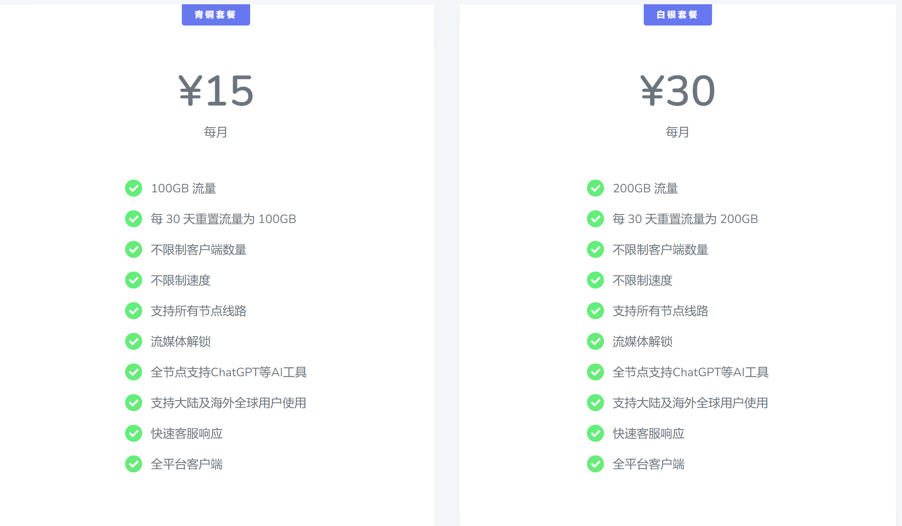](assets/review-images/be04f810d99df484-original.png)

### 套餐详情

<table style="border-collapse: collapse; width: 100%; height: 201px;">
<tbody>
<tr style="height: 26px;">
<td style="width: 11.2726%; text-align: center; height: 26px;"><strong>套餐名称</strong></td>
<td style="width: 17.2596%; text-align: center; height: 26px;"><strong>青铜套餐</strong></td>
<td style="width: 17.1843%; text-align: center; height: 26px;"><strong>白银套餐</strong></td>
<td style="width: 16.8587%; text-align: center; height: 26px;"><strong>黄金套餐</strong></td>
<td style="width: 16.7585%; text-align: center;"><strong>钻石套餐</strong></td>
</tr>
<tr style="height: 26px;">
<td style="width: 11.2726%; text-align: center; height: 26px;">月流量</td>
<td style="width: 17.2596%; text-align: center; height: 26px;">100G</td>
<td style="width: 17.1843%; text-align: center; height: 26px;">200G</td>
<td style="width: 16.8587%; text-align: center; height: 26px;">500G</td>
<td style="width: 16.7585%; text-align: center;">1000GB</td>
</tr>
<tr style="height: 26px;">
<td style="width: 11.2726%; text-align: center; height: 26px;">月付</td>
<td style="width: 17.2596%; text-align: center; height: 26px;">15元</td>
<td style="width: 17.1843%; text-align: center; height: 26px;">30元</td>
<td style="width: 16.8587%; text-align: center; height: 26px;">75元</td>
<td style="width: 16.7585%; text-align: center;">150元</td>
</tr>
<tr style="height: 26px;">
<td style="width: 11.2726%; text-align: center; height: 26px;">季付</td>
<td style="width: 17.2596%; text-align: center; height: 26px;">41元</td>
<td style="width: 17.1843%; text-align: center; height: 26px;">81元</td>
<td style="width: 16.8587%; text-align: center; height: 26px;">203元</td>
<td style="width: 16.7585%; text-align: center;">405元</td>
</tr>
<tr>
<td style="width: 11.2726%; text-align: center;">半年</td>
<td style="width: 17.2596%; text-align: center;">77元</td>
<td style="width: 17.1843%; text-align: center;">153元</td>
<td style="width: 16.8587%; text-align: center;">383元</td>
<td style="width: 16.7585%; text-align: center;">765元</td>
</tr>
<tr style="height: 26px;">
<td style="width: 11.2726%; text-align: center; height: 26px;">年付</td>
<td style="width: 17.2596%; text-align: center; height: 26px;">144元</td>
<td style="width: 17.1843%; text-align: center; height: 26px;">288元</td>
<td style="width: 16.8587%; text-align: center; height: 26px;">720元</td>
<td style="width: 16.7585%; text-align: center;">1440元</td>
</tr>
<tr>
<td style="width: 11.2726%; text-align: center;">套餐详情</td>
<td style="text-align: left; width: 51.3026%;" colspan="4">每 30 天重置流量，不限制客户端数量，不限制速度，支持所有节点线路，多数流媒体解锁，客服支持，全平台客户端。</td>
</tr>
</tbody>
</table>

---

## 光年梯vpn

光年梯由新加坡团队运营，提供IPLC与IEPL Trojan线路，标称最高速率2.5Gbps。节点覆盖香港、台湾、日本、新加坡、马来西亚与美国等地区，1倍率计费，每30天重置流量。支持Netflix、Disney+、ChatGPT与Claude，支付方式包括支付宝、微信与USDT。

👉 **[光年梯VPN官网注册入口](https://so.dianlanla.com/guangnianti)**

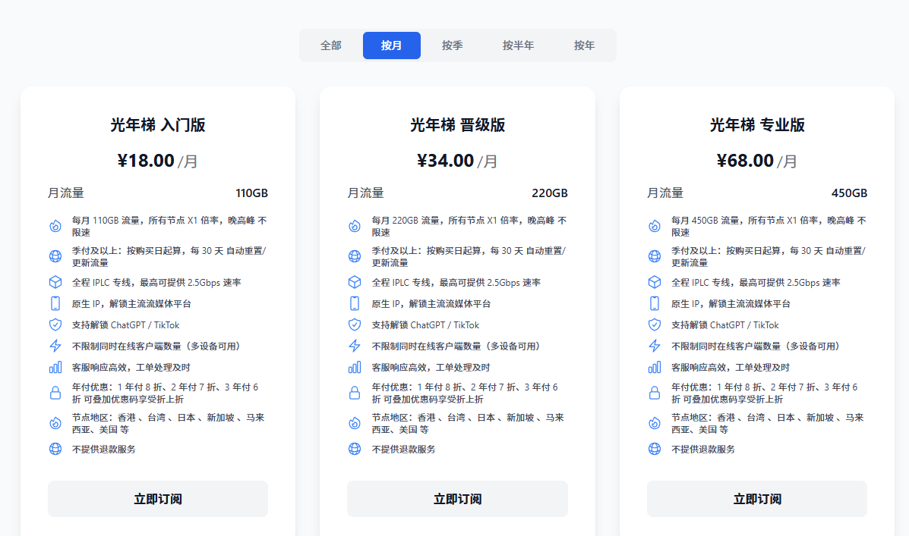

### 光年梯套餐

| 套餐名 | 月费 | 流量/月 | 设备数 | 协议/线路 | 特殊功能 |
|---|---|---|---|---|---|
| 入门版 | 18 元 | 110 GB | 不限 | IPLC 专线 / Trojan / SS | 1 倍率，晚高峰不限速 |
| 晋级版 | 34 元 | 220 GB | 不限 | IPLC 专线 / Trojan / SS | 1 倍率，原生 IP |
| 专业版 | 68 元 | 450 GB | 不限 | IPLC 专线 / Trojan / SS | 支持流媒体与AI工具 |
| 至尊版 | 130 元 | 900 GB | 不限 | IPLC 专线 / Trojan / SS | 大流量重度使用 |
| 独享私人专线 | 680 元 | 500 GB | 不限 | IEPL 专线（独立带宽 + 独立公网 IP） | 一人一线，可定制地区 |

共享节点不提供退款；独享专线开通后同样不退。

选购时按自己的月用量对照110GB、450GB等配额；视频时长、画质和下载习惯都会改变消耗。家庭或多设备并发另核对共享条件；独享专线按独立带宽、地址与地区需求比较。

---

## 龙猫云VPN

龙猫云是一家成立于2023年的节点服务，主要提供Shadowsocks和Trojan协议的节点，支持Android、iOS、macOS、Windows和Linux，支持Netflix、Disney+等流媒体和ChatGPT。

**特点**：
IPLC专线：按套餐开放范围选择节点。

多协议支持：支持Shadowsocks和Trojan协议，适应不同网络环境。

全平台支持：提供Windows、Mac、iOS、Android等多平台客户端。

流媒体解锁：支持解锁Netflix、Disney+等流媒体服务。

AI服务支持：支持ChatGPT等AI服务。

客户服务：提供文档、视频教程与客服支持。

👉 **[龙猫云VPN官网注册入口](https://so.dianlanla.com/longmaoyun)**

[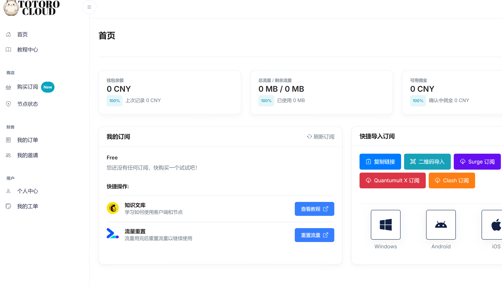](assets/review-images/958fd1772bbe523d-original.png)

###  套餐详情介绍

| 套餐            | 价格    | 时长  | 每月流量               | 速率   | 其他特点                                                     |
| --------------- | ------- | ----- | ---------------------- | ------ | ------------------------------------------------------------ |
| **VIP1**        | ¥15.00  | 1个月 | 100GB                  | 无限速 | IPLC专线，解锁ChatGPT、TikTok，原生IP解锁流媒体，不限制客户端 |
| **VIP2**        | ¥30.00  | 1个月 | 200GB                  | 无限速 | 同上                                                         |
| **VIP3**        | ¥60.00  | 1个月 | 400GB                  | 无限速 | 同上                                                         |
| **VIP4**        | ¥120.00 | 1个月 | 1000GB                 | 无限速 | 同上                                                         |
| **DIY定制套餐** | ¥680.00 | 1个月 | 0GB（独享IP+独享带宽） | 无限速 | 适用于TikTok直播、跨境电商，需工单或TG私聊咨询       ---

---

## 夜煞云VPN

夜煞云VPN成立于2022年，提供大陆国际专线和IPLC线路，支持多运营商接入、流媒体及ChatGPT。

夜煞云使用了secure加密隧道，用于代理流量传输。

支付方式支持支付宝和微信。

表中列套餐原价，订单可用优惠见结算页。

👉 **[夜煞云VPN官网注册入口](https://so.dianlanla.com/yeshayun)**

###  套餐详情介绍

| **套餐名称**         | **价格**      | **流量**          | **带宽**            | **适用人群**                  |
|----------------------|--------------|-------------------|---------------------|------------------------------|
| **Mini Plan - VIP**  | ¥58.00/年    | 50GB/月           | 最高2000Mbps        | **极轻度用户**，仅偶尔使用 |
| **Medium Plan - VIP** | ¥10.00/月    | 138GB/月          | 最高2000Mbps        | **普通用户**，流媒体+AI |
| **Standard Plan - VIP** | ¥19.80/月   | 288GB/月          | 最高2000Mbps        | **高清流媒体用户** |
| **Large Plan - VIP** | ¥29.80/月    | 520GB/月          | 最高2000Mbps        | **每月520GB用量** |
| **Pro Plan - VIP**   | ¥57.00/月    | 1024GB/月         | 最高2000Mbps        | **每月1024GB用量** |
| **不限时 Large+**    | ¥106.00/一次 | 400GB（永久有效） | 最高2000Mbps        | **一次性购买备用流量** |

### **推荐方案**
- **偶尔使用（轻量级流量）** → **Mini Plan（¥58/年, 50GB/月）**
- **日常流媒体 + AI** → **Medium Plan（¥10/月, 138GB/月）**
- **高质量流媒体（4K视频/大数据传输）** → **Large Plan（¥29.80/月, 520GB/月）**
- **每月1024GB流量需求** → **Pro Plan（¥57/月, 1024GB/月）**
- **长期备用流量（无时间限制）** → **不限时 Large+（¥106, 400GB）**

[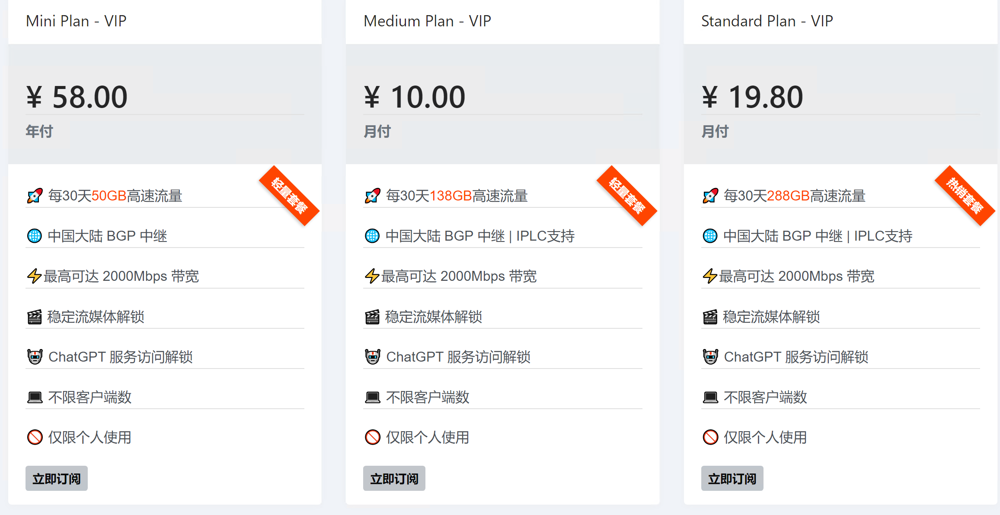](assets/review-images/376afd7867cd63bb-original.png)

---
## YToo（歪兔）-VPN

YToo（歪兔）-VPN 成立于2021年，支持主流的 Shadowsocks（SS）和 Trojan 协议，适配广泛设备与客户端，便捷易用。

节点覆盖亚洲、欧美等地区。支持Netflix港、台、美、日等区，以及Hulu、HBO Max、Disney+、TVB、AbemaTV、DAZN等平台；按目标平台和账号地区选择节点。

🔹 YToo节点与支持范围：

成立于2021年，付款周期见下表

支持 SS / Trojan 协议，连接快速且灵活

节点覆盖亚洲、美洲、欧洲等主要区域

支持多地区流媒体

适合日常上网、远程办公、游戏加速、内容访问等多种用途

### 🌐 **YToo 套餐价格表**

| 套餐      | 月付 | 半年付 | 年付 | 备注       |
| --------- | ---- | ------ | ---- | ---------- |
| **BASIC** | ¥36  | ¥219   | ¥372 | -          |
| **PLUS**  | ¥54  | ¥328   | ¥558 | -          |
| **PRO**   | ¥108 | ¥648   | ¥996 | -          |
| **AIR**   | -    | -      | ¥98  | 特别版年付 |

💡 说明建议：

- `AIR` 表中只列¥98年付，流量额度和可用线路未在这张表给出，购买前需另行核对。
- `PRO` 月付¥108；是否提供自己需要的流量、线路与设备数，应按套餐说明判断。
- BASIC 月付¥36，连续12个月为¥432；年付¥372约为其8.6折。折扣之外，也要比较首次支出与后续服务风险。

***
## xgcloud-VPN

**xgCloud**提供BGP中转节点，入门、进阶套餐使用BGP线路，专业、旗舰套餐另含IPLC／IEPL线路。节点覆盖中国香港、台湾、日本、新加坡、美国、德国、荷兰、芬兰、英国等地区，各档线路和流量见下表。
 **xgCloud 特色**：
- **全球覆盖**：提供多区域节点，便于按地区与用途选择
- **流媒体解锁**：支持 **Netflix、HULU、HBO、TVB、动画疯** 等热门平台  
- **AI工具解锁**：部分线路支持 **ChatGPT** 等工具  
- **线路范围**：入门和进阶列BGP，专业和旗舰另含IPLC／IEPL

👉 **[xgcloud-VPN官网注册入口](https://so.dianlanla.com/xgcloud)**

[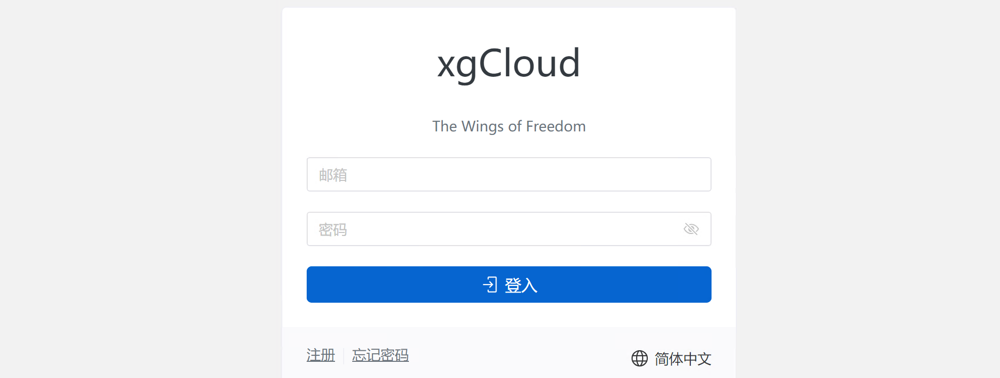](assets/review-images/9c961f2a9cd8149b-original.png)

###  套餐详情介绍

| 套餐名称         | 月费     | 流量 | 支持节点                             | 其他特点                                                                 |
|------------------|----------|------|--------------------------------------|--------------------------------------------------------------------------|
| 入门版套餐       | ¥20      | 120GB | 主流地区BGP隧道中转节点（50个）     | 解锁Netflix、Disney+、HBO，部分节点解锁ChatGPT、TikTok，SS/VMess协议  |
| 进阶版套餐       | ¥30      | 200GB | 所有地区BGP隧道中转节点（67个）     | 解锁Netflix、Disney+、HBO，部分节点解锁ChatGPT、TikTok，SS/VMess协议  |
| 专业版套餐       | ¥50      | 500GB | 所有地区BGP隧道中转节点（67个），包括IPLC/IEPL专线节点（10个） | 解锁Netflix、Disney+、HBO，部分节点解锁ChatGPT、TikTok，SS/VMess协议  |
| 旗舰版套餐       | ¥100     | 1200GB| 所有地区BGP隧道中转节点（67个），包括IPLC/IEPL专线节点（10个） | 解锁Netflix、Disney+、HBO，部分节点解锁ChatGPT、TikTok，SS/VMess协议  |

| 流量包名称         | 价格     | 流量 | 支持节点                             | 其他特点                                                                 |
|--------------------|----------|------|--------------------------------------|--------------------------------------------------------------------------|
| 100G流量包         | ¥66      | 100GB| 主流地区BGP隧道中转节点（50个）     | 解锁Netflix、Disney+、HBO，部分节点解锁ChatGPT、TikTok，SS/VMess协议  |
| 200G流量包         | ¥88      | 200GB| 主流地区BGP隧道中转节点（50个）     | 解锁Netflix、Disney+、HBO，部分节点解锁ChatGPT、TikTok，SS/VMess协议  |
| 500G流量包         | ¥188     | 500GB| 主流地区BGP隧道中转节点（50个）     | 解锁Netflix、Disney+、HBO，部分节点解锁ChatGPT、TikTok，SS/VMess协议  |
| 1000G流量包        | ¥288     | 1000GB| 主流地区BGP隧道中转节点（50个）    | 解锁Netflix、Disney+、HBO，部分节点解锁ChatGPT、TikTok，SS/VMess协议  |
| [专线]200G流量包   | ¥200     | 200GB| 专线节点（10个）                    | 解锁Netflix、Disney+、HBO，部分节点解锁ChatGPT、TikTok，SS/VMess协议  |

 选购建议：
- **入门版套餐**包含120GB流量，支持流媒体，适合日常轻度使用。
- **进阶版套餐**适合需要更多流量和更广泛节点覆盖的用户，包含200GB流量。
- **专业版套餐**适合需要高流量和专线节点支持的用户，提供500GB流量，并包含IPLC/IEPL节点。
- **旗舰版套餐**适合高需求用户，提供1200GB流量，并包含所有节点和专线节点支持。

流量包方面：
- 100G包适合已有明确少量需求的人比较，先看一次价格与有效期。
- 200G和500G包增加总量，分别用价格除以额度比较每GB成本，再看能否在有效期内用完。
- 1000G包需要更多预付款；按预计总消耗选择，不因包大就囤积超出自己用途的流量。

---
## V2free-VPN

V2free提供代理节点和客户端订阅，主要使用条件如下：

主要特点：

- **多运营商优化**：提供面向不同运营商的连接选择。
- **数据加密和代理**：提供SS及V2Ray客户端订阅路线；V2Ray是软件体系，节点使用的具体协议从账户说明查看。
- **全球网络支持**：支持访问ChatGPT、YouTube、Facebook、Twitter等全球网络服务，以及解锁TikTok、Netflix、Disney+、HBO等流媒体。
- **客户端与协议**：提供V2Ray客户端路线及SS节点，适用于Windows、macOS、iOS、Android和Linux等多平台。
- **加密传输**：使用代理协议传输数据，协议支持、运营商限速与连接干扰需分别判断。
- **付款周期**：月付与年付分别比较首次支出和每月额度。
- **设备支持**：Windows、Mac、Android、iOS与Linux按对应教程导入。
- **平台支持**：支持流媒体、社交网站与AI工具。
- **试用**：¥5、5天5GB，原表注明最多购买2次。

- [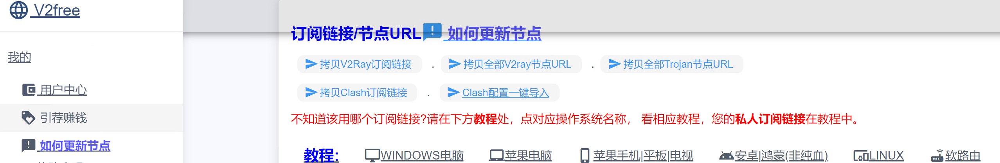](assets/review-images/98198e2095fa29ba-original.png)

### 🚀 **套餐对比表**

| **套餐**         | **价格** | **流量**             | **账号有效期** | **可用设备** | **速率限制** | **VIP等级** | **可用节点** | **适合人群**              |
| ---------------- | -------- | -------------------- | -------------- | ------------ | ------------ | ----------- | ------------ | ------------------------- |
| **试用套餐**     | ¥5       | 5GB                  | 5天            | 不限         | 无限制       | VIP1        | VIP1         | 仅试用，适合短期体验      |
| **月付A**        | ¥20      | 100GB                | 31天           | 不限         | 无限制       | VIP1        | VIP1         | 轻度用户，普通浏览        |
| **月付B**        | ¥39      | 200GB                | 31天           | 不限         | 无限制       | VIP1        | VIP1         | 中度用户，流媒体观看      |
| **月付C**        | ¥58      | 300GB                | 31天           | 不限         | 无限制       | VIP1        | VIP1         | 适合重度流媒体用户        |
| **月付D**        | ¥110     | 600GB                | 31天           | 不限         | 无限制       | VIP1        | VIP1         | 适合超重度用户/多设备使用 |
| **年付A**        | ¥168     | 100GB/月             | 365天          | 不限         | 无限制       | VIP2        | VIP1、VIP2   | 长期用户，流量适中        |
| **年付B**        | ¥258     | 200GB/月             | 365天          | 不限         | 无限制       | VIP2        | VIP1、VIP2   | 适合稳定观看流媒体        |
| **年付C**        | ¥338     | 300GB/月             | 365天          | 不限         | 无限制       | VIP2        | VIP1、VIP2   | 每月300GB，个人多设备用途        |
| **年付D**        | ¥668     | 600GB/月             | 365天          | 不限         | 无限制       | VIP2        | VIP1、VIP2   | 超大流量需求用户          |
| **年付E**        | ¥1100    | 1000GB/月            | 365天          | 不限         | 无限制       | VIP2        | VIP1、VIP2   | 每月1000GB用量         |
| **三年套餐A**    | ¥378     | 100GB/月             | 3年            | 不限         | 无限制       | VIP2        | VIP1、VIP2   | 长期用户，经济实惠        |
| **三年套餐B**    | ¥580     | 200GB/月             | 3年            | 不限         | 无限制       | VIP2        | VIP1、VIP2   | 高性价比长久使用          |
| **三年套餐C**    | ¥758     | 300GB/月             | 3年            | 不限         | 无限制       | VIP2        | VIP1、VIP2   | 适合稳定长久用户          |
| **年付G**        | ¥2000    | 2000GB/月            | 365天          | 不限         | 无限制       | VIP2        | VIP1、VIP2   | 每月2000GB用量       |
| **年付A+TikTok** | ¥1000    | 100GB/月 + 300GB流量 | 365天          | 不限         | 无限制       | VIP3        | VIP1、VIP2   | 适合TikTok解锁用户        |
| **年付C+TikTok** | ¥1170    | 300GB/月 + 300GB流量 | 365天          | 不限         | 无限制       | VIP3        | VIP1、VIP2   | 适合TikTok高流量用户      |

🎯 **推荐建议**
- **仅尝试体验** 👉 **试用套餐 ¥5**（5天5GB，仅限2次）  
- **普通使用（上网、轻度流媒体）** 👉 **月付A ¥20 / 年付A ¥168**（100GB/月）  
- **观看流媒体（YouTube 4K、Netflix、Disney+）** 👉 **月付B ¥39 / 年付B ¥258**（200GB/月）  
- **每月300GB流量需求** 👉 **月付C ¥58 / 年付C ¥338**（300GB/月）  
- **大流量需求** 👉 **月付D ¥110 / 年付D ¥668**（600GB/月）  
- **最高级别VIP、超大流量需求** 👉 **年付G ¥2000**（2000GB/月）  
- **含TikTok项目的套餐，IP是否独享需另确认** 👉 **年付A+TikTok ¥1000 / 年付C+TikTok ¥1170**  

---
## XSUS-VPN

### 套餐与IP限制补充（资料日期：2026-09-07）

四档月付记录为¥12/168GB、¥24/336GB、¥30/420GB、¥70/1024GB；按量包为¥65/188GB、¥82/240GB、¥122/400GB、¥260/1024GB；IEPL季付两档为¥52/每月50GB、¥88/每月100GB。月付、季付与按量包可按使用频率和流量需求选择，购买时核对套餐价格。

限制写的是最多5个IP，普通套餐还说明同一网络下多台设备计1个IP。条款写月流量不结转、一次性包重复购买会重置而不是叠加，因收款限制无法原路退款。专属客户端教程覆盖Windows、macOS、Linux、Android、iOS，另有第三方备用路线。

👉 **[XSUS官网注册入口](https://so.dianlanla.com/xsus)**

XSUS-VPN提供国际专线和多运营商接入，通过加密隧道传输代理流量，支持流媒体和ChatGPT。订阅可导入Clash、[Quantumult X](https://github.com/John19187/proxy-client-guides/blob/main/downloads/quantumult-x/README.md#import)等通用客户端；支持支付宝和微信付款。

[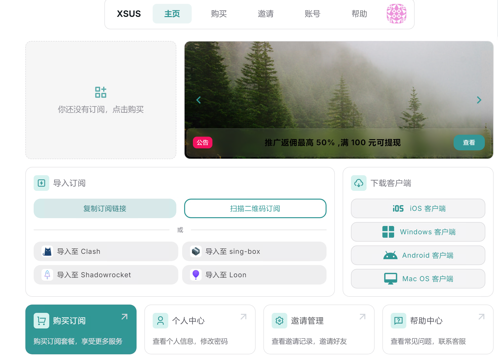](assets/review-images/b6e2808d2cb4a7d5-original.png)

###  套餐详情介绍

| **套餐**       | **价格（月付，2026-09-07记录）** | **流量**  | **标称带宽（原表）**  | **适合人群**                         |
| -------------- | ---------------- | --------- | --------- | ------------------------------------ |
| **Small-基础** | ¥12.00            | 168GB/月  | 500Mbps   | **轻量级用户**（日常浏览 + 流媒体）  |
| **Plus-进阶**  | ¥24.00           | 336GB/月  | 1Gbps     | **中等需求**（4K视频 + 远程办公）    |
| **MAX-专业**   | ¥30.00           | 420GB/月  | 1Gbps     | **高需求用户**（流媒体+AI工具）      |
| **Ultra-极限** | ¥70.00           | 1024GB/月 | 5Gbps突发 | **高流量、多设备需求**，仍按最多5个IP计数 |

### **流量包对比** 📦  

| **流量包** | **价格（2026-09-07记录）** | **流量** | **标称带宽（原表）** | **适用人群**                  |
| ---------- | -------- | -------- | -------- | ----------------------------- |
| **188GB**  | ¥65.00   | 188GB    | 1Gbps    | **一次性补充**（轻量用户）    |
| **240GB**  | ¥82.00   | 240GB    | 未明确    | **间歇使用**，按实际用量扣除 |
| **400GB**  | ¥122.00  | 400GB    | 1Gbps    | **中等流量需求**              |
| **1024GB** | ¥260.00  | 1024GB   | 1Gbps    | **高流量需求**（AI/高清流媒体） |

---
## TAG-VPN

TAG-VPN支持多运营商接入，通过加密隧道传输代理流量。节点覆盖美国、日本、台湾、香港、新加坡等地区，支持Netflix、HBO Max、Amazon Prime Video、Disney Now、Disney+等流媒体和ChatGPT。订阅可导入Clash、[Quantumult X](https://github.com/John19187/proxy-client-guides/blob/main/downloads/quantumult-x/README.md#import)等通用客户端；支持支付宝、微信和USDT付款。

TAG有电脑和安卓一键-VPN客户端，iOS需要搭配[小火箭](https://github.com/John19187/proxy-client-guides/blob/main/downloads/shadowrocket/README.md#import)使用。TAG -VPN除了包月套餐外，也有按量付费套餐，限时1年，用完即止。

- [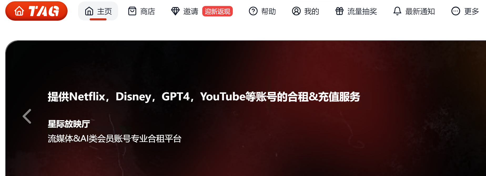](assets/review-images/d262e4eab16cc5d2-original.png)

👉 **[TAG-VPN官网注册入口](https://so.dianlanla.com/tagvpn)**

###  套餐详情介绍

| 计划名称         | 价格     | 流量     | 支持节点                         | 其他特点                                                                 |
|------------------|----------|----------|----------------------------------|--------------------------------------------------------------------------|
| **Bronze计划**   | ¥176/季  | 每月250GB | 全球100+地区，250+条线路         | 解锁Netflix、Hulu、HBO、Disney+、Dazn等流媒体，最多10个IP同时连接，分享订阅会永久封号，不保证TikTok能用。海外用户无法使用。 |
| **Silver计划**   | ¥109/月  | 每月500GB | 全球100+地区，250+条线路         | 解锁Netflix、Hulu、HBO、Disney+、Dazn等流媒体，最多10个IP同时连接，分享订阅会永久封号，不保证TikTok能用。海外用户无法使用。 |
| **Gold计划**     | ¥209/月  | 每月999GB | 全球100+地区，250+条线路         | 解锁Netflix、Hulu、HBO、Disney+、Dazn等流媒体，最多10个IP同时连接，分享订阅会永久封号，不保证TikTok能用。海外用户无法使用。 |
| **Special计划**  | ¥154/年  | 每年200GB | 全球100+地区，250+条线路         | 解锁Netflix、Hulu、HBO、Disney+、Dazn等流媒体，最多10个IP同时连接，分享订阅会永久封号，不保证TikTok能用。海外用户无法使用。 |
| **Team计划**     | ¥627/月  | 每月3000GB| 全球100+地区，250+条线路         | 解锁Netflix、Hulu、HBO、Disney+、Dazn等流媒体，最多30个IP同时连接，分享订阅会永久封号，不保证TikTok能用。海外用户无法使用。 |
| **私人节点定制** | ¥???/月  | 每月1TB+  | 任意全球地区，专线出国             | 按需求解锁流媒体或应用，支持TikTok，自选代理协议，设备无限制，价格根据地区和需求定制。 |

选购建议：
- **Bronze计划**适合普通用户，流量和功能都比较适中，适合轻度流媒体使用。
- **Silver计划**为中度需求用户提供更多流量（500GB/月），适合常看流媒体。
- **Gold计划**为重度用户提供更多月流量，适合流量需求较大的人群。
- **Special计划**适合微型需求用户，年付价格较为优惠，但流量较少。
- **Team计划**是单列商品，流量与IP／设备条件见该行；多人使用按该商品明确的许可范围选择。
- **私人节点定制**是为特殊需求用户设计的套餐，可以根据需要进行定制。

所有套餐和计划均不保证海外用户使用，并且某些应用（如抖音、快手等）不能保证修改定位。

[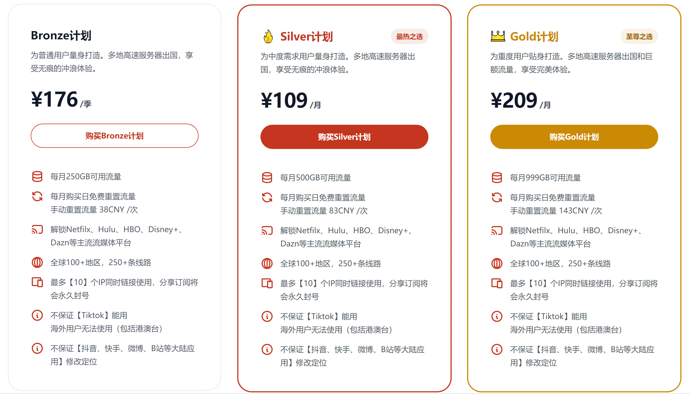](assets/review-images/74099777458e8b73-original.png)

---
## STC-SPADES-VPN
STC-SPADES通过数据中心加密转发代理流量，设有国内5大中转出口、全球7大数据中心和100多个落地节点，覆盖美国、日本、台湾、香港、新加坡等地区。支持Netflix、HBO Max、Amazon Prime Video、Disney Now、Disney+等流媒体和ChatGPT。订阅可导入Clash、[Quantumult X](https://github.com/John19187/proxy-client-guides/blob/main/downloads/quantumult-x/README.md#import)等通用客户端；支持支付宝和微信付款。
提供SSR节点、V2Ray客户端订阅及IPLC线路。使用官网客户端时，按本家的系统教程安装并登录。

👉 **[STC-SPADES-VPN官网注册入口](https://so.dianlanla.com/stcspades)**

[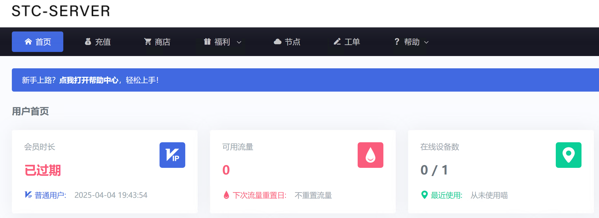](assets/review-images/7be7b1b47f8556a1-original.png)

###  套餐详情介绍

| **套餐**       | **月付** | **季付** | **半年付** | **年付** | **特点**                                |
|--------------|--------|--------|--------|--------|---------------------------------|
| **基础套餐**  | ¥38    | ¥108   | ¥205   | ¥385   | 标准节点，部分原生内容解锁       |
| **进阶套餐**  | ¥48    | ¥136   | ¥258   | ¥488   | 国内中转+国际优化节点             |
| **旗舰套餐**  | ¥88    | ¥251   | ¥475   | ¥898   | 高可用故障转移节点               |
| **企业套餐**  | ¥108   | ¥308   | ¥583   | ¥1100  | 额外专线节点，按本档范围选择             |

🎯 **推荐选择**
✅ **基础需求** 👉 **基础套餐（¥38/月）**，适合一般使用  
✅ **比较进阶档的中转范围** 👉 **进阶套餐（¥48/月）**，国内中转优化  
✅ **比较旗舰档的故障转移条款** 👉 **旗舰套餐（¥88/月）**，故障转移保障  
✅ **企业级需求** 👉 **企业套餐（¥108/月）**，专线范围按对应商品说明  

📌 **注意**：
- **支持完善使用文档 & 在线客服（非实时）**
- **购买后不支持退款**
- **部分原生内容解锁，不保证可用**  

各档未在价格表中列流量额度，购买前先补齐额度、节点范围和设备条件。  

---
## SpeedCAT闪电猫-VPN
闪电猫提供SS节点与第三方客户端订阅，全球120多个节点，标称带宽上限5Gbps，通过加密隧道传输代理流量。支持流媒体和ChatGPT，订阅可导入Clash、[Quantumult X](https://github.com/John19187/proxy-client-guides/blob/main/downloads/quantumult-x/README.md#import)等通用客户端；V2Ray客户端需选择兼容的订阅格式。支持支付宝和微信付款。

### **套餐对比与选择指南** 🚀  

| **套餐** | **价格（月付/年付）** | **流量** | **适用人群** |
|---------|----------------|---------|-------------|
| **特惠年付小包** | ¥98/年 | 50GB/月（重置） | **低流量轻量用户** |
| **迷你猫** | ¥20/月 | 100GB/月（重置） | **日常浏览+流媒体** |
| **闪电猫** | ¥40/月 | 200GB/月（重置） | **中度使用，4K视频** |
| **霹雳猫** | ¥100/月 | 500GB/月（重置） | **高流量用户** |
| **雷神猫** | ¥200/月 | 1000GB/月（重置） | **每月1000GB用量** |
| **流星猫** | ¥260/年 | 600GB/年（不重置） | **间歇性使用者** |
| **飞天猫** | ¥1800/年 | 5000GB/年（不重置） | **年总量5000GB用量** |

### **流量包对比** 📦  
| **流量包** | **价格** | **流量** | **适用情况** |
|-----------|--------|---------|-------------|
| **50GB** | ¥10 | 50GB | **临时补充** |
| **100GB** | ¥20 | 100GB | **适中补充** |
| **500GB** | ¥100 | 500GB | **大流量补充** |
| **1000GB** | ¥200 | 1000GB | **极限需求** |

 **推荐方案**
💡 **轻度使用者**（偶尔使用） → **特惠年付小包 ¥98/年**  
💡 **中等需求**（流媒体+ChatGPT） → **迷你猫 ¥20/月**  
💡 **每月流量与本人设备需求** → **闪电猫 ¥40/月**  
💡 **高负载用户**（AI工具+远程办公） → **霹雳猫 ¥100/月**  
💡 **超高流量需求** → **雷神猫 ¥200/月**  
💡 **长期使用但流量不重置** → **流星猫/飞天猫（按年付）**  

## 红杏-VPN

红杏VPN支持多运营商接入，通过加密隧道传输代理流量。节点覆盖美国、日本、台湾、香港、新加坡等地区，支持Netflix、HBO Max、Amazon Prime Video、Disney Now、Disney+等流媒体和ChatGPT。订阅可导入Clash、[Quantumult X](https://github.com/John19187/proxy-client-guides/blob/main/downloads/quantumult-x/README.md#import)等通用客户端；支持支付宝和微信付款。

👉 **[红杏VPN官网注册入口](https://so.dianlanla.com/hongxing)**

[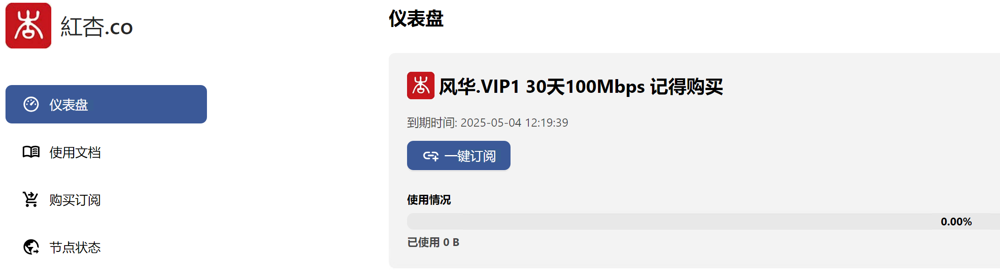](assets/review-images/147038f5f251b87c-original.png)

###  套餐详情介绍

下表为历史套餐价格，供旧订单对照。新购查看红杏账户商店中的付款周期、月流量、速率和设备限制。

| 套餐 | 付款周期 | 周期总价 | 月流量 | 带宽标称 | 设备数 |
|---|---|---|---|---|---|
| 轻纱.SVIP1 | 季付 | ¥54 | 80GB | 100Mbps | 2 |
| 轻纱.SVIP1 | 半年 | ¥100 | 80GB | 200Mbps | 2 |
| 轻纱.SVIP1 | 年付 | ¥180 | 80GB | 300Mbps | 2 |
| 风华.SVIP1 | 月付 | ¥25 | 100GB | 100Mbps | 2 |
| 风华.SVIP1 | 季付 | ¥70 | 100GB | 100Mbps | 2 |
| 风华.SVIP1 | 半年 | ¥135 | 100GB | 100Mbps | 2 |
| 风华.SVIP1 | 年付 | ¥255 | 100GB | 1000Mbps | 2 |
| 绯梦.SVIP2 | 月付 | ¥35 | 200GB | 200Mbps | 4 |
| 绯梦.SVIP2 | 季付 | ¥100 | 200GB | 200Mbps | 4 |
| 绯梦.SVIP2 | 半年 | ¥180 | 200GB | 200Mbps | 4 |
| 绯梦.SVIP2 | 年付 | ¥340 | 200GB | 1000Mbps | 4 |
| 霓裳.SVIP3 | 月付 | ¥45 | 400GB | 500Mbps | 5 |
| 霓裳.SVIP3 | 季付 | ¥130 | 400GB | 500Mbps | 5 |
| 霓裳.SVIP3 | 半年 | ¥240 | 400GB | 500Mbps | 5 |
| 霓裳.SVIP3 | 年付 | ¥440 | 400GB | 1000Mbps | 5 |
| 智慧商企SVIP | 月付 | ¥168.88 | 1024GB | 2000Mbps | 未说明 |
| 智慧商企SVIP | 季付 | ¥488.88 | 1024GB | 2000Mbps | 未说明 |
| 智慧商企SVIP | 半年 | ¥988.88 | 1024GB | 2000Mbps | 未说明 |
| 智慧商企SVIP | 年付 | ¥1888.88 | 1024GB | 2000Mbps | 未说明 |
| 有为商企SVIP | 月付 | ¥338.88 | 3000GB | 2000Mbps | 未说明 |
| 有为商企SVIP | 季付 | ¥888.88 | 3000GB | 2000Mbps | 未说明 |
| 有为商企SVIP | 半年 | ¥1888.88 | 3000GB | 2000Mbps | 未说明 |
| 有为商企SVIP | 年付 | ¥3688.88 | 3000GB | 2000Mbps | 未说明 |
| 企业Package Plan | 月付 | ¥558 | 6888GB | 原表标“无限制” | 未说明 |
| 企业Package Plan | 季付 | ¥1688 | 6888GB | 原表标“无限制” | 未说明 |
| 企业Package Plan | 半年 | ¥3288 | 6888GB | 原表标“无限制” | 未说明 |
| 企业Package Plan | 年付 | ¥6388 | 6888GB | 原表标“无限制” | 未说明 |

---
## Riolu 精灵学院-VPN

Riolu.443精灵学院于2023年开业，提供Shadowsocks、VLESS＋Reality、Hysteria等协议节点，线路有直连和隧道中转，月付从¥6／30GB起，另有不限时按量包。支持流媒体与ChatGPT，使用时选择兼容所选协议的客户端。

[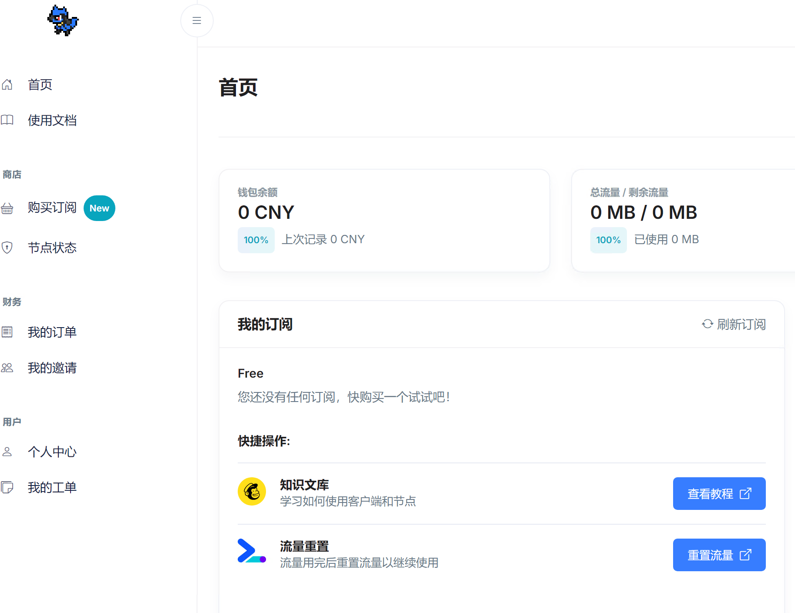](assets/review-images/925a6d20f327ab67-original.png)

###  套餐详情介绍

| 套餐名称             | 价格 | 时长       | 流量额度 | 其他特点                                           |
| -------------------- | ---- | ---------- | -------- | -------------------------------------------------- |
| **Iron**             | ¥6   | 1个月      | 30GB/月     | 适合轻度用户，支持流媒体 & ChatGPT，**无EMBY支持** |
| **Copper**           | ¥12  | 1个月      | 120GB/月    | 适合一般用户，支持EMBY海量资源观看                 |
| **Silver**           | ¥24  | 1个月      | 240GB/月    | 适合流媒体爱好者，解锁Netflix等                    |
| **Gold**             | ¥36  | 1个月      | 360GB/月    | 适合大流量需求                                     |
| **Platinum**         | ¥48  | 1个月      | 480GB/月    | 高流量用户选择                                     |
| **Diamond**          | ¥60  | 1个月      | 600GB/月    | 超大流量，支持流媒体 & ChatGPT                     |
| **Small（不限时）**  | ¥60  | **一次性** | 400GB总量    | 适合长期使用，不限时流量                           |
| **Medium（不限时）** | ¥90  | **一次性** | 600GB总量    | 中等需求，不限时流量                               |
| **Large（不限时）**  | ¥120 | **一次性** | 800GB总量    | 大量流量用户，不限时                               |

**推荐建议**

- **轻度用户（浏览网页 & 少量流媒体）** ➝ **Iron ¥6/月**
- **一般用户（观看流媒体，解锁AI）** ➝ **Copper ¥12/月**
- **流媒体爱好者（频繁观看 & 4K需求）** ➝ **Silver ¥24/月**
- **大流量用户（高清视频 & 直播）** ➝ **Gold ¥36/月 或 Platinum ¥48/月**
- **长期用户（无需按月订阅）** ➝ **不限时流量套餐**

---

## Coffee Cloud 咖啡云-VPN

咖啡云（Coffee Cloud）运营多年，主营公网隧道中转，也提供少量 IEPL 专线节点。套餐以咖啡命名，价位整体偏低，具体档位见下方价格表。

协议方面，除常规的 Shadowsocks 与 AnyTLS 外，还提供自研的 V-Ninja；V-Ninja 需导入官方专用客户端才能使用，不想额外装客户端用 Shadowsocks 订阅即可。支付方式为支付宝与 USDT。

👉 **[Coffee Cloud咖啡云VPN官网注册入口](https://so.dianlanla.com/coffeecloud)**

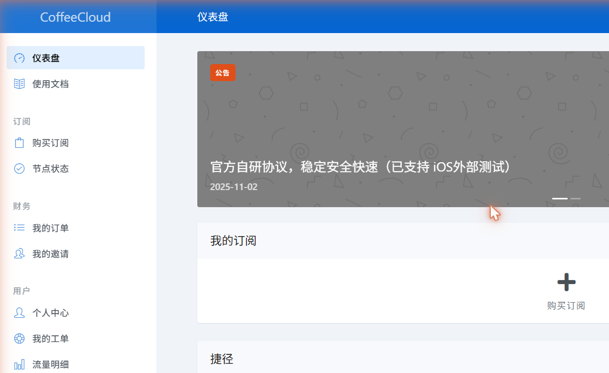

### 套餐价格表

| 套餐 | 月付 | 流量/月 | 线路 | 协议 |
| --- | --- | --- | --- | --- |
| 美式 | ¥10 | 130G | 中转 | SS / AnyTLS / V-Ninja |
| 进阶（拿铁 / 摩卡等） | ¥20 起 | 300G+ | 中转 + 少量 IEPL | SS / AnyTLS / V-Ninja |
| 高档 | 约 ¥60 封顶 | 至 1024G | 中转 + IEPL | SS / AnyTLS / V-Ninja |

> 套餐价格来自历史第三方评测资料，当前档位和价格从本家购买页核对。

**选购建议**

- 历史美式档列¥10／130G；按这个旧价对照订单时，先确认对应流量周期，当前购买另看本家商品。
- 每月用量在300G左右：旧评测列¥20起的进阶档，按所选套餐的实际额度计算单位流量价格。
- 对游戏、直播延迟敏感：按同一目标和时段比较延迟与丢包。

咖啡云旧评测的美式档列月付¥10、130GB；需要IEPL或V-Ninja时，另外确认相应线路和客户端条件。

------
## 咪兔 Mitu-VPN

### 套餐与适用地区补充（资料日期：2026-08-31）

基础版月付¥9.80/90GB、¥15.80/150GB、¥29.80/300GB、¥45.80/500GB，标示3台设备；高级版月付¥14.80/64GB、¥28.80/128GB、¥56.80/256GB、¥113.80/512GB，标示5台。流量包按量用完为止，不是每月重新发放。

咪兔在新疆和中国大陆以外地区不可用，不提供退款。可使用各系统官方客户端、[FlClash](https://github.com/John19187/proxy-client-guides/blob/main/downloads/flclash/README.md#packages)与[Shadowrocket](https://github.com/John19187/proxy-client-guides/blob/main/downloads/shadowrocket/README.md#import)。2026年8月31日，咪兔通知旧客户端用户按官网教程重新下载软件；迁移前可按[更新与恢复步骤](https://github.com/John19187/proxy-client-guides#update)保存原配置。

查看咪兔2026-08-31套餐原图

咪兔的套餐分为月付和流量包，再分别区分基础版与高级版。选择时先确认自己的每月用量，再比较付款方式；不要把流量包的容量当成每月都会重置的额度。

2026 年 8 月 31 日的官网记录中，基础版月付为 ¥9.80／90 GB 至 ¥45.80／500 GB，高级版月付为 ¥14.80／64 GB 至 ¥113.80／512 GB。这是当时记录的价格，最新套餐、地区限制与使用说明以官网为准。

👉 **[咪兔官网注册入口](https://so.dianlanla.com/mitu)**

## 红杏云

红杏云按每月用量划分套餐，三档月付分别包含200GB、500GB和800GB。不限制设备数量，允许家庭成员共享，仅限个人及家庭使用。

👉 **[红杏云官网注册入口](https://so.dianlanla.com/hongxingyun)**

### 月付套餐与使用限制

三档月付套餐可按每月流量需求选择。

| 套餐 | 月付价格 | 每月流量 | 标称带宽 | 设备说明 |
|---|---:|---:|---:|---|
| 轻量·包月200G | ¥20 | 200GB/月 | 300Mbps | 不限制，支持家庭成员共享 |
| 冲浪·包月500G | ¥40 | 500GB/月 | 500Mbps | 不限制，支持家庭成员共享 |
| 豪华·包月800G | ¥60 | 800GB/月 | 800Mbps | 不限制，支持家庭成员共享 |

三档均可选月付、季付、半年、年付、2年付和3年付，也可购买重置包；表中为月付价格，其他周期可在商店切换查看。采用IEPL专线，支持流媒体，赠送EMBY影视库，**暂不支持退款**。使用时可按目标地区选择节点。

[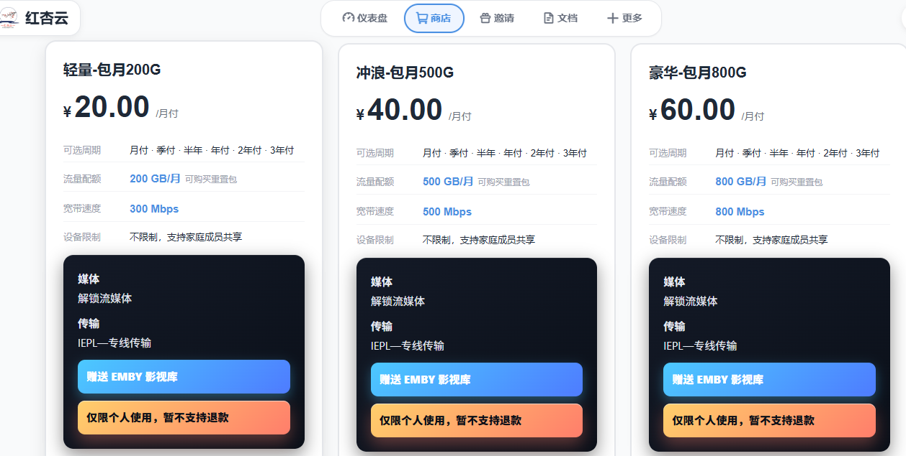](assets/review-images/a741dbf017424367-original.png)

客户端配置按红杏云使用文档操作。

## oixcloud

oixCloud的Iron标有可能不适用于中国大陆网络，Alu在套餐截图中售罄。个人套餐的区别主要在可用线路、高速流量和单端限速。需要广港线路时，要从含Fusion的档位比较；不能只看到最便宜的Iron年付价，就认为能使用与Silver相同的线路。

👉 **[oixCloud官网注册入口](https://so.dianlanla.com/oixcloud)**

### 个人套餐：年付总价与周期额度

以下比较四档个人年付套餐。价格是一次支付的年付总价，高速流量是对应订阅周期额度，不是每月重置额度。

| 套餐 | 年付总价 | 高速流量（周期总额） | 单端标称限速 | 线路范围 |
|---|---:|---:|---:|---|
| Pass Iron | ¥192/年 | 2000GiB | 500Mbps | Edge；页面提示可能不适用于中国大陆网络 |
| Pass Alu | ¥240/年 | 800GiB | 100Mbps | Edge、CIA、IXP；页面显示售罄 |
| Pass Bronze | ¥384/年 | 1200GiB | 200Mbps | Edge、CIA、IXP |
| Pass Silver | ¥576/年 | 2500GiB | 300Mbps | Edge、CIA、IXP、Fusion广港专线 |

个人套餐注明个人使用、不可共享；单端限速不是设备数量，GiB也不直接换算成表里其他服务的GB。年付有效期为365天，Silver的¥576年付折算约¥48/月，仅方便比较支出，年付下单仍按全年总价支付。高速配额、低速流量与临界值分别按所选套餐规则查看。

[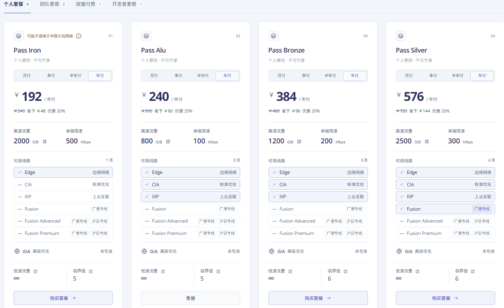](assets/review-images/9a00826fd35e522a-original.png)

商店还提供更高档个人、团队和按量产品，可按个人、多用户协作或间歇使用等场景选择。流媒体与AI访问需结合套餐线路范围，当前套餐及规则从本章登记入口进入账户页核对。

## VPN套餐与客户端横向比较

下表将前文8家主要服务的费用、客户端与选择条件放在一起比较。具体套餐、来源日期与适用条件见上方各品牌说明。历史价格与当前可购项分开看，按实际付款周期计算首次支出。

| 服务 | 套餐与费用口径 | 客户端或设备 | 选择时注意 |
|---|---|---|---|
| **星云-VPN** | 月付¥18/100GB、¥38/300GB、¥53.60/500GB；年付从¥76起，每月额度按档重置（11月5日资料） | 本家专属客户端 | 年付总价与月额度分开；同时登录数按档位 |
| **Cloud-VPN** | 入门月付¥9.6、108GB；另有不同月流量档及不限时总量包 | 按本家设备与教程支持范围 | 月付、年付折算和一次性总量分开比较 |
| 闪连VPN | 周付¥34.33、月付¥89.37、季付¥206.33、年付¥584.73 | 原生客户端，3台同时连接 | 周期总价与并发设备条件一起比较 |
| 杨帆云VPN | 月付LV1至旗舰¥19.99/29.99/39.99/49.99/88.99，流量100至1200GB | UniClash，2至6台按档位 | 节点等级按套餐开放，第三方客户端不作为本家售后路线 |
| WgetCloud VPN | 新购按当前商店的季付/年付比较；正文另留旧订单规格 | 通用订阅客户端，可用IP数按档位 | 每30天配额随付款周期不同；新购使用当前商店报价 |
| 大哥云VPN | 月付¥19.9/100GB、¥29/150GB；季付¥69/200GB月；年付档见正文 | 专属与第三方路线，按本家教程 | 按月重置；新疆不可用、不支持原路退款 |
| 星链云VPN | 月付¥20/220GB、¥30/480GB、¥40/720GB、¥60/1400GB；另有总量包（9月7日记录） | 多平台专属客户端，无在线设备限制的资料口径见正文 | 周期流量与总量包分开，按实际套餐范围选择 |
| 极客云VPN | 月付¥19.99至¥99.99，对应100至1200GB | 2至10台按档位 | 设备数、节点等级与速率分别比较 |

## 电脑与手机如何选客户端、导入订阅

先从自己的服务账户取得目标软件对应格式。有些服务只提供自有App；例如星云已公告停止第三方订阅，按其专属客户端登录。其他服务是否开放通用订阅，仍看本家说明，不能把账号密码填进URL框。

| 当前设备与输入 | 直接进入具体教程 | 使用条件 |
|---|---|---|
| Windows／Mac的Clash或Mihomo配置 | [Rev下载与导入](https://github.com/John19187/proxy-client-guides/blob/main/downloads/clash-verge-rev/README.md#import)、[Clash Party订阅管理](https://github.com/John19187/proxy-client-guides/blob/main/downloads/clash-party/README.md#import) | 对应系统、CPU及完整兼容配置 |
| 桌面节点订阅 | [v2rayN订阅分组与活动节点](https://github.com/John19187/proxy-client-guides/blob/main/downloads/v2rayn/README.md#import) | Windows／macOS／Linux使用各自安装包和适配节点 |
| Android | [CMFA完整配置](https://github.com/John19187/proxy-client-guides/blob/main/downloads/cmfa/README.md#import)、[v2rayNG节点分组](https://github.com/John19187/proxy-client-guides/blob/main/downloads/v2rayng/README.md#import)、[Surfboard兼容配置](https://github.com/John19187/proxy-client-guides/blob/main/downloads/surfboard/README.md#import) | 三种输入按本家给定格式分别处理 |
| iPhone／iPad | [Shadowrocket订阅](https://github.com/John19187/proxy-client-guides/blob/main/downloads/shadowrocket/README.md#import)、[Stash完整配置](https://github.com/John19187/proxy-client-guides/blob/main/downloads/stash/README.md#import)、[Loon订阅与策略](https://github.com/John19187/proxy-client-guides/blob/main/downloads/loon/README.md#import) | 商店供给、系统要求及服务是否提供相应配置 |
| 本家明确支持Nextin | [Nextin服务识别码与订阅URL](https://github.com/John19187/proxy-client-guides/blob/main/downloads/provider-app/README.md#import) | 按该服务的公开入口接入，不通用于所有账户 |
| Linux桌面 | [v2rayN安装包](https://github.com/John19187/proxy-client-guides/blob/main/downloads/v2rayn/README.md#packages)、[Rev Linux安装包](https://github.com/John19187/proxy-client-guides/blob/main/downloads/clash-verge-rev/README.md#packages) | 发行版、CPU和包型同时匹配 |
| OpenWrt路由器 | [OpenClash配置订阅](https://github.com/John19187/proxy-client-guides/blob/main/downloads/openclash/README.md#import)、[PassWall节点订阅](https://github.com/John19187/proxy-client-guides/blob/main/downloads/passwall/README.md#import) | 固件、插件、内核与服务的路由器条件 |

还没确定软件，再看[2026年机场通用客户端汇总与下载教程](https://github.com/John19187/proxy-client-guides#choose)按平台比较；已经决定用哪款，直接进入上面的二级页。电脑v2rayN与Android v2rayNG分别发行，程序、版本号和本地备份不能互换。

### Windows：用Rev导入自己的兼容订阅

还没安装，先从[Rev原包与系统条件](https://github.com/John19187/proxy-client-guides/blob/main/downloads/clash-verge-rev/README.md#packages)选CPU和包型；固定v2.5.10不支持Windows 7。

1. 原来正使用另一客户端，保存需要迁出的个人配置，关闭其系统代理与TUN，再从托盘退出。
2. 打开Rev“订阅”，在“订阅文件链接”粘贴个人Clash／Mihomo地址，点“导入”，等待新卡片出现。
3. 点选这份配置，到“代理”展开手动组，选择实际服务器。
4. 在“设置”开系统代理，用目标网页完成访问。普通浏览器已可用，无需为首次配置另开TUN。

地址只放自己的客户端，不公开到截图或聊天。下载、解析或空节点按[Rev对应错误处理](https://github.com/John19187/proxy-client-guides/blob/main/downloads/clash-verge-rev/README.md#import)定位；某个应用不跟随系统代理，转[Rev应用与TUN专题](https://github.com/John19187/proxy-client-guides/blob/main/clash-verge-rev-network.md)。

尝试失败先撤回本次启用的接管；需回旧软件，再恢复旧客户端及相配资料。普通网络仍未恢复，按[系统代理恢复](https://github.com/John19187/proxy-client-guides#restore-and-report)处理，不先删除全部配置。

### 月付、季付和按量包如何避免买错

月付¥13与季付¥29的首次支出不同，年付总量与每月重置也不是一回事。先列清实付金额、最低周期、额度重置与客户端路线；设备限制按台数或IP计数也要分开。服务调整节点时先更新原来源，出现协议或字段不支持再看[客户端与内核更新](https://github.com/John19187/proxy-client-guides#update)，不靠重买套餐修复格式错误。

## 近期连接与校园网DNS常见问题

### 节点能Ping通，为什么VPN还是连接超时？

系统Ping使用ICMP，回应只说明这类探测有返回；客户端的延迟按钮可能采用其他探测方式，需看当前客户端说明。接着查看握手结果，并打开要使用的网页或应用。

先从已保存的服务入口查看站内公告，再核对套餐与订阅状态。同一设备、客户端与节点换一条可用网络对照一次；实际目标页面能加载才算验证通过。不同结果如何解释，见[连接症状对照表](https://github.com/John19187/proxy-client-guides#symptom-table)。

### TCP受阻，换成UDP协议就一定能用吗？

TCP与UDP分别测试，QUIC基于UDP。只在本家提供相应节点、客户端支持时作对照，验证同一目标页面；具体测试方式见[TCP与UDP对照](https://github.com/John19187/proxy-client-guides#tcp-udp)。

### 校园网连不上，手机数据却正常，应该看哪里？

先用同一设备、软件和节点切到自己的手机流量，对照一次。手机流量能用时，可先沿这条连接完成自己的使用，再查看本校的校园网要求，不必反复重装VPN。

日常使用建议见[校园网与个人流量说明](https://github.com/John19187/ssr-v2ray-trojan-clash-guide#campus-use)；确实需要处理DNS设置时，再按[校园DNS检查与恢复](https://github.com/John19187/proxy-client-guides#campus-dns)操作。求助前遮住订阅、二维码和账号信息。

###  安全使用网络工具的注意事项

在使用网络连接工具时，应当了解并遵守当地的法律法规。不同国家和地区对这类工具的使用有不同规定，用户应确保自己的行为合法合规。

 #### 隐私保护措施

保护个人隐私是使用网络工具时的重要考量：
- 查看服务的日志政策及审计说明，按自己的隐私需求选择
- 登录重要账户时核对网址与设备安全，不向客服发送密码或验证码
- 从官方渠道查看客户端更新说明，安装适用的维护版本

#### 账户安全

保护您的账户安全同样重要：
- 使用独立强密码，发现泄露或异常登录时及时更换
- 开启双因素认证（如有提供）
- 避免在不安全的网络环境下登录账户

#### 选购服务时的实用建议：

- 优先考虑提供试用期或退款保证的服务
- 初次使用建议先购买短期套餐进行评估
- 注意辨别虚假宣传，不要轻信"100%安全"等绝对化承诺
- 选择有良好声誉和用户评价的服务提供商

#### 技术问题处理

使用过程中可能遇到的常见技术问题及解决方案：

- 连接失败：先看具体错误；同一节点、同一目标换自己的另一条网络比较，只在服务提供且客户端支持时另试协议。
- 速度慢：在相近时段比较现有节点，查看本地带宽、丢包和节点负载，保留同一目标便于对照。
- 某个应用不通：查看它是否进入代理及命中的规则；App确有分割隧道功能时，再按该功能的适用范围设置。
- 仅在确认浏览器状态导致问题时处理缓存或Cookie；这不会修复节点断线

### 敏感时期特别提示

重要工作前确认常用客户端和目标页面能正常访问，避免临到需要时才发现订阅过期或入口已经变更。

经常用AI工具、处理外贸业务、查阅海外资料或远程办公，可以在日常主用之外准备一两个符合用量的备用服务，平时少量使用、确认客户端与套餐仍有效，真正遇到线路维护时才有现成选择。

选到适合自己网络的服务，日常使用可以很顺手；遇到阶段性调整时，多留一条可切换的连接，比把工作安排都压在同一入口上更从容。

[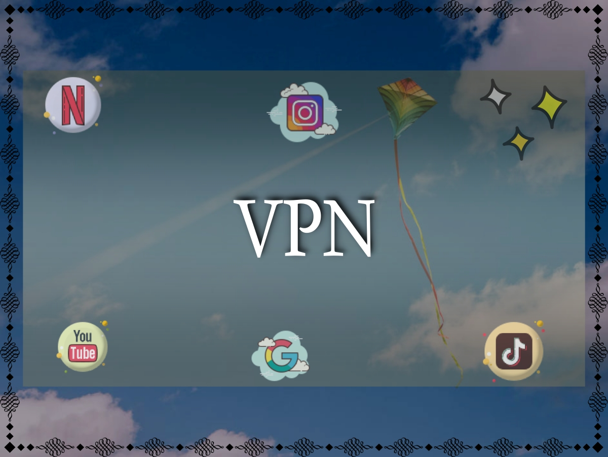](assets/review-images/c59861d063487357-original.jpg)

以上各款机场覆盖从高端专线到经济实惠各档位，可按自身需求与预算对照选择。

## 更新日志

展开更新日志

- 2026-11-16　折叠更新记录，收起许可说明，撤下不必要的维护数据与贡献提示入口。 比较区后移，补齐前8家并去除表内跳转链接。

- 2026-11-16　删除图片后的重复仓库自链，补充文末客户端与免费节点目录；明确国内中转与长期稳定不能画等号，补充节点暴露风险、AI识别说法的证据范围与重度用户备用建议。保留本帖的品牌图文、比较逻辑和推广入口。 补充超低价机场的交付、售后、停运与预付款风险。 图片恢复原件展示，撤掉后加的仓库署名条。

- 2026-11-15　前置部分服务的套餐与客户端横向表，按设备直达二级教程；统一接入、更新和环境背景的去向，保留原H1、品牌图文、推广入口与各日期套餐。

- 2026-11-14　按官网九档套餐校正三月七的价格、月流量与设备上限，补全家庭档，更新选购建议和比较表；清理第三方频道、重复导读与未核有效的旧优惠，补充仓内连接与DNS诊断资料及恢复步骤。

- 2026-11-08
  - 按客户端和实际用途介绍本清单，改写开头与选购说明，直接说明翻墙、海外网站及AI工具的使用方式；同步相关目录名称。
  - 补充4月国内中转调整、10月下旬重要会议前后TCP连接干扰与11月部分恢复的环境背景，说明当前选服务应一并考虑入口维护与客户端兼容。
  - 新增Ping与实际连接的区别、TCP和UDP协议选择、校园网DNS限制与mihomo配置含义的常见问题；主备搭配建议放在文末。
  - 更新Cloud-VPN、杨帆云、大哥云、泰山与泡泡Dog的带邀请码注册入口。
  - 按已有带日期资料统一星云、泰山、XSUS的价格、流量周期和设备/IP口径，修正部分特殊时期与匿名性绝对承诺；既有资料日期保留。
  - 星云另按11月5日已收资料更新同时登录客户端数、标称带宽和一次性包标价，并补年付Ultra档；与机场帖保持同源，较大一次性包的配额口径保留确认条件。
  - 补充星云官网已列的六个优惠码与适用周期，区分两年付公告和特惠套餐页的不同代码；未明折扣、截止日和叠加条件不作推断。
  - 清理过期的收录导读名称，现役清单保持44家。
  - 同步仓库已关闭Pull Requests的维护说明，保留MIT许可证、结构化清单与资料维护规范入口。

- 2026-10-09　新增红杏云、oixCloud及套餐原图，更新目录、价格周期比较与使用说明。

- 2026-09-16　补充套餐与客户端资料，调整狗狗加速、奶昔位置，更新推广入口并移除退役服务。

- 2026-08-01　增加 MIT 许可证、46 个服务商的结构化清单、贡献指南、数据校验和每周链接检查工作流
- 2026-07-27　全量核查 61 条服务商链接可达性，6 条访问不到；逐条追查后 3 家为更换域名、2 家已停运或转手
- 2026-07-19　星云 VPN 更换官网域名，链接已同步
- 2026-07-07　新增大哥云-VPN；Bitz Net-VPN 版位调整至飞鸟（FLYINGBIRD）之后
- 2026-06-24　杨帆云、Bitz Net 更换官网域名，链接已同步
- 2026-06-03　新增 Coffee Cloud 咖啡云-VPN
- 2026-05-02　更新五一月付、年付优惠码及 FASTLINK 套餐；更新 bygcloud 白月光官网链接；新增杨帆云、光年梯及 Bitz Net-VPN 官网入口

使用任何此类工具都应遵守当地法律法规、保持负责任的网络行为；下单前以官网当前套餐与线路为准。此清单按可核验资料增量更新，明确退役的服务从现役推荐移除，可收藏后定期回看。

## 客户端与相关资源目录

按设备和配置类型进入对应教程；旧版条目用于识别与迁移。软件之间的订阅、配置和备份条件仍以各篇说明为准。

展开客户端目录（含旧版与迁移说明）

| 客户端 | 设备或范围 | 教程用途 |
|---|---|---|
| [Clash Verge Rev](https://github.com/John19187/proxy-client-guides/blob/main/downloads/clash-verge-rev/README.md) | Windows／macOS／Linux | Clash／Mihomo配置与系统代理 |
| [FlClash](https://github.com/John19187/proxy-client-guides/blob/main/downloads/flclash/README.md) | 电脑／Android | 跨平台下载、导入与连接 |
| [Clash Party](https://github.com/John19187/proxy-client-guides/blob/main/downloads/clash-party/README.md) | Windows／macOS／Linux | 安装版、便携版与订阅管理 |
| [Clash Mi](https://github.com/John19187/proxy-client-guides/blob/main/downloads/clash-mi/README.md) | 跨平台 | 按本款入口导入Clash配置 |
| [ClashX Meta](https://github.com/John19187/proxy-client-guides/blob/main/downloads/clashx-meta/README.md) | macOS | 菜单栏客户端与Mihomo配置 |
| [v2rayN](https://github.com/John19187/proxy-client-guides/blob/main/downloads/v2rayn/README.md) | 电脑 | 节点订阅与系统代理 |
| [Hiddify](https://github.com/John19187/proxy-client-guides/blob/main/downloads/hiddify/README.md) | 电脑／手机 | 跨平台导入与连接 |
| [Karing](https://github.com/John19187/proxy-client-guides/blob/main/downloads/karing/README.md) | 电脑／手机 | 配置、规则与备份 |
| [Clash Meta for Android](https://github.com/John19187/proxy-client-guides/blob/main/downloads/cmfa/README.md) | Android | Clash配置与VPN授权 |
| [v2rayNG](https://github.com/John19187/proxy-client-guides/blob/main/downloads/v2rayng/README.md) | Android | 节点订阅与VPN连接 |
| [NekoBox for Android](https://github.com/John19187/proxy-client-guides/blob/main/downloads/nekobox/README.md) | Android历史版本 | 1.4.2旧版订阅与迁移 |
| [Surfboard](https://github.com/John19187/proxy-client-guides/blob/main/downloads/surfboard/README.md) | Android | 兼容配置与启动连接 |
| [sing-box](https://github.com/John19187/proxy-client-guides/blob/main/downloads/sing-box/README.md) | 多平台 | 版本匹配的JSON配置 |
| [Shadowrocket](https://github.com/John19187/proxy-client-guides/blob/main/downloads/shadowrocket/README.md) | iPhone／iPad | 节点、订阅与VPN连接 |
| [Stash](https://github.com/John19187/proxy-client-guides/blob/main/downloads/stash/README.md) | Apple设备 | 按本款条件导入Clash类配置 |
| [Quantumult X](https://github.com/John19187/proxy-client-guides/blob/main/downloads/quantumult-x/README.md) | iPhone／iPad | 节点资源与完整配置的区别 |
| [Loon](https://github.com/John19187/proxy-client-guides/blob/main/downloads/loon/README.md) | iPhone／iPad | 订阅、策略与分流 |
| [Surge](https://github.com/John19187/proxy-client-guides/blob/main/downloads/surge/README.md) | iOS／macOS | 按平台配置与接管流量 |
| [OpenClash](https://github.com/John19187/proxy-client-guides/blob/main/downloads/openclash/README.md) | OpenWrt | 固件条件、配置与插件 |
| [PassWall](https://github.com/John19187/proxy-client-guides/blob/main/downloads/passwall/README.md) | OpenWrt | 订阅节点与主开关 |
| [ShellCrash](https://github.com/John19187/proxy-client-guides/blob/main/downloads/shellcrash/README.md) | Linux／路由器 | 安装脚本与运行条件 |
| [Nextin](https://github.com/John19187/proxy-client-guides/blob/main/downloads/provider-app/README.md) | 按服务公开支持范围 | 服务指定Nextin时的安装与连接 |
| [Clash for Windows](https://github.com/John19187/proxy-client-guides/blob/main/downloads/cfw/README.md) | 旧版／迁移 | 识别旧配置并迁移 |
| [Clash for Android](https://github.com/John19187/proxy-client-guides/blob/main/downloads/cfa/README.md) | Android旧版／迁移 | 原版CFA与CMFA分开 |
| [ClashX](https://github.com/John19187/proxy-client-guides/blob/main/downloads/clashx/README.md) | macOS旧版 | 普通ClashX身份与迁移 |
| [ClashX Pro](https://github.com/John19187/proxy-client-guides/blob/main/downloads/clashx-pro/README.md) | macOS历史版本 | Pro托管配置与增强模式 |
| [旧Clash Verge](https://github.com/John19187/proxy-client-guides/blob/main/downloads/old-clash-verge/README.md) | 旧版／迁移 | 与Rev区分及迁移 |
| [NekoRay](https://github.com/John19187/proxy-client-guides/blob/main/downloads/nekoray/README.md) | 电脑旧版／迁移 | 旧资料与替代客户端 |
| [旧客户端迁移目录](https://github.com/John19187/proxy-client-guides/blob/main/downloads/legacy/README.md) | 旧版资料 | 按原客户端寻找迁移说明 |

| 相关文档 | 内容 |
|---|---|
| **VPN推荐与使用方式（本文档仓）** | 比较服务的平台、接入方式与客户端 |
| [机场推荐与套餐比较](https://github.com/John19187/ji-chang-tui-jian) | 比较月付、按量与套餐条件 |
| [2026年机场通用客户端汇总与下载教程](https://github.com/John19187/proxy-client-guides) | 按设备选软件并进入具体教程 |
| [机场与代理工具科普指南](https://github.com/John19187/ssr-v2ray-trojan-clash-guide) | 理解机场、协议、客户端、订阅与线路 |
| [免费节点与订阅资源](https://github.com/John19187/v2ray-SSR-Clash-Verge-Shadowrocke) | 查看公开资源与导入说明，不承诺持续可用 |

开源维护与许可

本文由John19187统一整理维护，实际修改记录见本页更新日志。原创文档采用[MIT许可](./LICENSE)；软件、商标及第三方材料的权利与使用范围见[素材说明](./NOTICE.md)。

